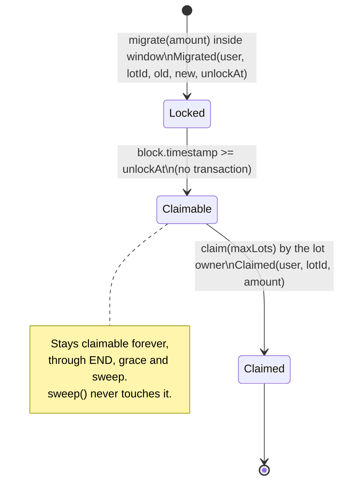

# Cojam token migration: contract specification

Status: draft for developer and auditor review, written 2026-11-12. The contracts are **not audited**. Code: [`contracts/`](../contracts/). How to build, test and deploy: [`contracts/README.md`](../contracts/README.md).

## 1. Overview

Cojam moves from the old CT token to a new, plain token on the same chain (Kaia mainnet, chain id 8217; testnet Kairos, chain id 1001).

| | Old token | New token |
| --- | --- | --- |
| Name, symbol | Cojam, CT | Cojam Token, CT |
| Address | `0x7f223b1607171b81ebd68d22f1ca79157fd4a44b` | set at deploy (created by the migration contract) |
| Decimals | 18 | 18 |
| Total supply | 4,083,262,533.9560001 CT (`4083262533956000100000000000` base units, read on chain 2026-11-12) | exactly the same number, fixed |
| Admin | owner `0xeb16…0518` (not controlled by the team) can pause, freeze and lock | none |

The migration rules, all enforced by code:

* **1:1.** One old base unit becomes one new base unit. Same decimals, so there is no scaling, no rounding and no dust.
* **Self service.** A holder approves old CT and calls `migrate(amount)`. Each call opens a **lot** that unlocks 7 days later. After unlock the holder calls `claim(maxLots)` and receives new CT.
* **Window.** `migrate` works from `START` (inclusive) to `END = START + 365 days` (exclusive). `claim` works forever.
* **Same rules for everyone.** No allowlist, no exclusions, no rewards, no bonus, no minimum.
* **No admin key.** Nothing is pausable, upgradeable or configurable after deploy. Nobody can move locked user funds, change the ratio or change the lock.
* **Remainder.** After `END + grace`, anyone can call `sweep()`, which sends the new CT that no lot is owed to the treasury multisig fixed at deploy. Tokens owed to unclaimed lots are never touched.

A note on the supply figure: the supply is usually quoted as 4,083,262,533.956 CT. The real on chain value carries one more digit, 0.0000001 CT (`100000000000` base units). The new token copies the on chain value to the last base unit, and the deploy reverts if the two ever differ. Site copy may keep the rounded figure but should not claim it is exact to the base unit.

## 2. Wallets and addresses

| Role | Address | Holds | Powers |
| --- | --- | --- | --- |
| **Token contract** (`CojamToken`) | created by the migration contract in its constructor | nothing of its own | none: no owner, no mint, no pause, no blacklist, no fee, no upgrade |
| **Swap contract** (`CojamMigration`) | set at deploy | the new CT reserve (the whole supply at deploy) and every old CT received through `migrate` | none: it only follows its code. No function can move old CT out. New CT leaves only through `claim` (to the lot owner) and `sweep` (to the treasury, only the unowed part, only after `END + grace`) |
| **Treasury multisig** | `TREASURY`, immutable, set at deploy | receives the unowed remainder after `END + grace` | none over the contracts. It is only a destination |
| **Deployer EOA** | any fresh key | gas only (KAIA). Holds no new CT after deploy: the deploy script checks this | none after the deploy transaction |

* The treasury (issuance wallet) is a **brand new multisig created for the relaunch**, recommended as a Kaia Safe with a threshold such as 3 of 5 held by separate people and devices. It is not any wallet from the old Cojam project. The old owner `0xeb1622d0377da1f9815bfc6eff61afe3257a0518` is unrelated to the relaunch and must never be used as the treasury; the deploy script refuses it.
* The deployer is a single use key. It is not the treasury and it is never given any role, because the contracts have no roles.
* **No address can move locked user funds.** Not the deployer, not the treasury, not the team. A lot's new CT can only ever go to the address that created the lot, through `claim`.
* The old CT owner keeps its powers over old CT (section 6). It has no power over the new token or the swap contract.

## 3. Contracts and exact behaviour

Compiler: Solidity 0.8.28, optimizer on (200 runs), EVM target `paris` (no PUSH0, no transient storage, so the bytecode runs on every Kaia hardfork). Libraries: OpenZeppelin Contracts 5.4.0 (`ERC20`, `ERC20Permit`, `SafeERC20`, `SafeCast`, `ReentrancyGuard`).

### 3.1 `CojamToken`

* `ERC20("Cojam Token", "CT")` plus `ERC20Permit("Cojam Token")` (EIP-2612, domain version `"1"`).
* `TOTAL_SUPPLY = 4083262533956000100000000000` (constant).
* Constructor `(address recipient)`: mints `TOTAL_SUPPLY` to `recipient`. OpenZeppelin reverts on the zero address. There is no other mint path.
* Nothing else: no owner, no `burn`, no pause, no blacklist, no hooks, no fee, no proxy.

**KIP-7 compatibility.** Kaia runs the EVM, and Kaia wallets, Kaiascan and Kaia DEXs handle ERC-20 tokens natively, so the token works on Kaia as is. KIP-7 is Kaia's token standard: it is ERC-20 plus `safeTransfer` / `safeTransferFrom` with an `onKIP7Received` receiver callback, plus KIP-13 `supportsInterface`. Recommendation: **do not add KIP-7 extras and do not answer `supportsInterface` for KIP-7.** Reasons: answering `supportsInterface(0x65787371)` without the `safeTransfer` functions would be a false claim; adding them brings receiver callbacks (a re-entry surface) to a token whose value is being plain and neutral; and KIP-13 detection is not needed for ERC-20 style listing on Kaia. Pre launch action: confirm with each target exchange that an ERC-20 style token on Kaia is accepted (checklist item).

### 3.2 `CojamMigration`

**Constructor** `(IERC20 oldToken, address treasury, uint256 start, uint256 gracePeriod)`, in order:

1. Revert `ZeroAddress` if `oldToken` or `treasury` is zero.
2. Revert `StartInPast` if `start < block.timestamp`.
3. Revert `GracePeriodTooLong` if `gracePeriod > 365 days` (catches unit mistakes).
4. Revert `DecimalsMismatch` unless `oldToken.decimals() == 18`.
5. Deploy `new CojamToken(address(this))`: the whole supply is minted to the swap in the same transaction. No other address ever holds it first, so there is no trust gap between token deploy and funding.
6. Revert `SupplyMismatch` unless `newToken.totalSupply() == oldToken.totalSupply()` at deploy time. Any old CT burn before deploy therefore stops the deploy, and the constant must be re-checked.
7. Store immutables: `OLD_TOKEN`, `NEW_TOKEN`, `TREASURY`, `START`, `END = start + 365 days`, `SWEEP_OPENS_AT = END + gracePeriod`.

**`migrate(uint256 amount) returns (uint256 lotId)`**, `nonReentrant`:

1. Revert `ZeroAmount` if `amount == 0`; `NotStarted` if `now < START`; `WindowClosed` if `now >= END`.
2. Read the swap's old CT balance, call `OLD_TOKEN.safeTransferFrom(msg.sender, this, amount)`, read the balance again.
3. `received = after - before`. Revert `NothingReceived` if nothing arrived; revert `ReceivedMoreThanSent` if `received > amount`.
4. `newAmount = received` (1:1). Revert `ReserveExhausted` if `newAmount > availableReserve()`. With the supply check at deploy this cannot happen with the real old CT (it has no mint); it is a guard, not a policy.
5. Append lot `{amount: newAmount, unlockAt: now + 7 days}` to `msg.sender`'s list; `lotId` is its index.
6. `totalMigrated += received; totalOwed += newAmount`; emit `Migrated`.

Old CT received stays in the swap contract forever (section 8.1 explains why).

**`claim(uint256 maxLots) returns (uint256 amount)`**, `nonReentrant`:

1. Start at `nextClaimIndex[msg.sender]`. Walk at most `maxLots` lots in id order. Stop at the first lot with `now < unlockAt`.
2. Sum the walked lots and emit `Claimed(user, lotId, amount)` for each.
3. Revert `NothingToClaim` if the sum is zero (no lots, none matured, or `maxLots == 0`).
4. Move the cursor, `totalOwed -= amount`, `totalClaimed += amount`, then `NEW_TOKEN.safeTransfer(msg.sender, amount)`.

Why a cursor is correct: `LOCK_PERIOD` is a constant and block time never goes backwards, so a user's lots unlock in id order. A lot is claimed exactly when its id is below the cursor. The `maxLots` bound means a wallet with any number of lots can always claim in several transactions: no unbounded loop can brick a user. Measured: 25 lots in one call cost 219,530 gas.

**`sweep() returns (uint256 amount)`**, `nonReentrant`, callable by anyone:

1. Revert `SweepNotOpen` if `now < SWEEP_OPENS_AT`.
2. `amount = availableReserve() = NEW_TOKEN.balanceOf(this) - totalOwed`. Revert `NothingToSweep` if zero.
3. `totalSwept += amount`; emit `Swept(TREASURY, amount)`; transfer `amount` to `TREASURY`.

It can be called again later (for example if someone sends new CT to the contract by mistake). It can never reduce the balance below `totalOwed`, because `migrate` is closed after `END` and so `totalOwed` can only go down.

**Views**: `availableReserve()`, `isOpen()`, `lotCount(user)`, `lotOf(user, lotId) → (amount, unlockAt, claimed)`, `claimable(user, maxLots) → (amount, lots)`, `pendingOf(user)` (all unclaimed, matured or not; loops, view only), public counters `totalMigrated`, `totalOwed`, `totalClaimed`, `totalSwept`, `nextClaimIndex(user)`, and the immutables.

**Invariants** (checked after every step of the fuzz tests):

* `NEW_TOKEN.balanceOf(swap) >= totalOwed`
* `totalOwed == sum of unclaimed lot amounts`
* `NEW_TOKEN.balanceOf(swap) + totalClaimed + totalSwept == TOTAL_SUPPLY`
* `totalMigrated == totalOwed + totalClaimed`
* `OLD_TOKEN.balanceOf(swap) >= totalMigrated` (equal unless someone sent old CT directly)

## 4. Parameters

| Parameter | Value | Where set | Changeable |
| --- | --- | --- | --- |
| Ratio | 1:1 (base unit for base unit) | code | no |
| Decimals | 18 and 18 | code, checked at deploy | no |
| New supply | 4,083,262,533.9560001 CT | `CojamToken.TOTAL_SUPPLY`, checked against old supply at deploy | no |
| Lock per lot | 7 days (604,800 s) | `LOCK_PERIOD` constant | no |
| Window | 365 days from `START` | `WINDOW` constant | no |
| `START` | launch time (open decision) | constructor | no |
| Grace period | recommended 30 days, max 365 | constructor | no |
| `TREASURY` | new relaunch Safe multisig | constructor | no |
| Old token | `0x7f223b1607171b81ebd68d22f1ca79157fd4a44b` | constructor | no |

## 5. Lot state diagram

Contract phases: before `START` (nothing open), window `[START, END)` (migrate and claim), after `END` (claim only), from `SWEEP_OPENS_AT` (claim and sweep).

## 6. What the old token can do (read from chain)

The old contract's source is not verified by us. A scan of its deployed bytecode on 2026-11-12 found these owner functions: `pause()`, `unPause()`, `freeze(address)`, `unFreeze(address)`, lock functions (`unlock(address,uint256)`, `unlockAll(address)`, `releaseLock(address)`, `lockInfo(address,uint256)`, `totalLocked(address)`, plus three selectors we could not name), `transferOwnership`, `renounceOwnership`. It has `burn` and `burnFrom`. It has **no** `mint`, no `permit`, no KIP-7 `safeTransfer`, no `supportsInterface`. On chain: owner `0xeb1622d0377da1f9815bfc6eff61afe3257a0518`, `paused() == false`, balances mapping at storage slot 1.

Fork tests against the real bytecode confirmed: `pause()` blocks `transferFrom` (so `migrate` reverts) but claims of existing lots keep paying; `freeze(holder)` blocks that holder from migrating; `freeze(swapContract)` does **not** block migrate or claim, because the swap never sends old CT.

## 7. Events and errors

**Events**

| Event | When |
| --- | --- |
| `Migrated(address indexed user, uint256 indexed lotId, uint256 oldAmount, uint256 newAmount, uint256 unlockAt)` | each successful `migrate`. `oldAmount` is what actually arrived; `newAmount == oldAmount` |
| `Claimed(address indexed user, uint256 indexed lotId, uint256 amount)` | once per lot paid by `claim` |
| `Swept(address indexed to, uint256 amount)` | each successful `sweep` |

Plus the standard ERC-20 `Transfer` and `Approval` on both tokens. A front end can rebuild a wallet's full history from `Migrated` and `Claimed` filtered by `user`.

**Custom errors**

| Error | Raised by | Meaning |
| --- | --- | --- |
| `ZeroAddress` | constructor | old token or treasury is zero |
| `StartInPast` | constructor | `start` is before the deploy block |
| `GracePeriodTooLong` | constructor | grace above 365 days |
| `DecimalsMismatch` | constructor | old or new token is not 18 decimals |
| `SupplyMismatch` | constructor | new supply differs from the old `totalSupply()` |
| `ZeroAmount` | migrate | amount is zero |
| `NotStarted` | migrate | before `START` |
| `WindowClosed` | migrate | at or after `END` |
| `NothingReceived` | migrate | the transfer moved no old CT into the swap |
| `ReceivedMoreThanSent` | migrate | more arrived than `amount` (non standard token) |
| `ReserveExhausted` | migrate | not enough unowed new CT (unreachable with real old CT) |
| `NothingToClaim` | claim | no matured unclaimed lot within `maxLots` |
| `SweepNotOpen` | sweep | before `SWEEP_OPENS_AT` |
| `NothingToSweep` | sweep | every new CT in the swap is owed to lots |
| `ReentrancyGuardReentrantCall` | all three (OpenZeppelin) | re-entry attempt |

Errors coming from old CT itself (allowance, balance, paused, frozen) bubble up unchanged through `SafeERC20`. The front end should map them to the states in HANDOFF 4.4 (approval needed, insufficient balance, old token paused).

## 8. Design decisions and reasons

### 8.1 Received old CT stays in the swap contract (not `0x…dEaD`, not `burnFrom`)

* **Freeze risk decides it.** The old owner can `freeze` any address, and a frozen address cannot send. A design that forwards old CT to `0x…dEaD` inside `migrate` would be bricked for everyone by one `freeze(swap)` call. Holding in place cannot be blocked that way (proved on the fork).
* **`burnFrom` is unwise here.** Its behaviour inside unverified code (allowance handling, interaction with pause, freeze and locks, events) is not something we control, and it still needs the same approval. It would also make the received amount harder to measure and shrink the old `totalSupply`, which removes a clean cross check.
* **It is as good as burned.** The swap has no function that can move old CT, and no admin or upgrade path. `OLD_TOKEN.balanceOf(swap)` is a public, exact ledger of everything migrated. Supply trackers can treat that address as locked forever.
* **Cheaper.** One transfer per migrate instead of two.

### 8.2 No admin key

The contracts have no owner, no pause, no upgrade, no parameter setters. The only privileged outcome (the remainder going to the treasury) is time gated, permissionless to trigger and limited to unowed tokens. This removes the most common migration failure modes (key theft, insider moves, ratio changes) and keeps the new token listing neutral.

The cost is that nothing can be stopped if a bug appears after launch. Mitigations: external audit, full testnet run, a small mainnet dry run with team wallets, and a contract small enough to review line by line (about 250 lines). The worst case of a swap bug is bounded by what it holds: old CT already migrated, and new CT not yet claimed.

**Alternative (not built): multisig plus timelock.** If the founder or auditor wants an emergency brake, add a `pauseMigrate` role held by a Safe behind a timelock (for example 48 hours). It may pause **only** `migrate`, never `claim` or `sweep`, and may never move tokens, change the ratio, the lock, the window or the treasury. HANDOFF 4.2 lists more admin powers (top up, recover other tokens); none are needed here because the reserve is the full supply from block one and there is nothing to top up.

### 8.3 Token deployed by the swap

The swap's constructor creates `CojamToken(address(this))`. The supply exists only inside the swap from the first block, and the deployer never holds any. The supply and decimals cross checks run in the same transaction.

### 8.4 Measured credit

The credit is the swap's balance change, not the requested amount. Fee on transfer or other non standard behaviour can never over credit (tested with a 1% fee mock and in fuzz runs with a 0.37% fee). The real CT has no fee (fork test: credit equals amount).

### 8.5 Checks, effects, interactions

`claim` and `sweep` follow checks, effects, interactions strictly. `migrate` must call old CT before writing state, because the credit is the measured balance change. This is the standard pattern for measured transfers; `nonReentrant` on all three state changing functions closes the gap, and the old token is a fixed, known contract, not user input. Tests show a malicious token that re-enters `migrate`, `claim` or `sweep` from inside `transferFrom` is rejected, and a swallowed re-entry gains nothing.

### 8.6 No permit based migrate

Old CT has no `permit` (EIP-2612), so a one signature migrate is impossible. Holders send two transactions: approve, then migrate. Contract wallets such as Safe can batch both atomically (MultiSend), which is tested. The front end should approve the exact amount, not an unlimited allowance. The new token does support `permit`, for later DEX and app use.

### 8.7 Lots and cursor claims

Each `migrate` call is its own lot with its own 7 day timer. A cursor per user plus a `maxLots` bound gives constant cost per lot, no unbounded loops, and no per lot `claimed` flag to store. Only the caller can create lots for itself, so lot spam can only affect the spammer, and even then it is just more claim transactions.

### 8.8 Kaia specifics

* Kaia fee delegated transactions work: `msg.sender` is the sender, not the fee payer, so a sponsored gas flow does not change who owns a lot.
* Kaia account key changes (role based keys) do not affect ownership: lots are keyed by address.
* Hardhat needs a hardfork history entry to fork chain 8217 (`hardhat.config.js`).

## 9. Edge case policies

| Case | Policy |
| --- | --- |
| **Tokens on exchanges** (MEXC, any Korean exchange still holding CT) | The holder of record is the exchange. The exchange migrates its own balance through the same contract (it is a normal caller) or credits users with new CT by its own process. Publish the list of supporting exchanges and their dates. No special contract path. |
| **Klayswap LP** | LP tokens are not old CT. Holders remove liquidity first, then migrate the returned CT. The pool's own CT can only be migrated by the pool's withdrawers. Show an inline hint on the migrate page. |
| **Vesting or locked contracts** | A contract holding old CT can migrate only if it can call `approve` and `migrate` (and later `claim`) on arbitrary targets. If it cannot, its beneficiaries must get the CT out first. There is no admin path, by design. Ask known vesting holders before launch. |
| **Contract wallets (Safe, multisig)** | Fully supported. No `tx.origin`, no EOA checks; lots belong to `msg.sender`. Approve and migrate can be one batched Safe transaction. Tested with a contract wallet mock; test a real Safe on Kairos before launch. |
| **Lost keys** | Old CT in a lost wallet cannot be migrated by anyone. After `END + grace`, its matching share of new CT is part of the remainder that goes to the treasury. Any later compensation is an off chain treasury policy. |
| **Lost keys after migrating** | The lot stays claimable forever, but only by that address. Nobody can redirect it. |
| **Late migrators** | `migrate` reverts from `END`. The late policy (if any) is paid by the treasury from the swept remainder, off chain. Show the deadline everywhere. Open decision. |
| **Tiny balances** | No minimum. Any amount from 1 base unit migrates exactly; the "Max" button should send the whole balance so nothing is left behind. |
| **Old CT paused by the unknown owner** | `migrate` reverts for everyone while paused; existing lots keep unlocking and paying. Fallback: take a snapshot of old CT balances at the pause block (balances cannot change while paused, so anyone can verify it) and publish a Merkle root. Funding: the swap has no admin, so the unmigrated reserve stays inside until `END + grace`, then goes to the treasury, which funds a Merkle claim contract for the snapshot. Cost of this design: the fallback can only pay out after `SWEEP_OPENS_AT`. Mitigation before launch: find the old owner and ask for `renounceOwnership()` (removes pause and freeze for good), or accept the risk explicitly. |
| **Holder frozen or locked by the old owner** | That holder (or that locked part) cannot migrate. Same fallback as a pause: evidence on chain, treasury funded claim after `SWEEP_OPENS_AT`. |
| **Old CT still transferable and trading** | Old CT keeps trading after launch and after `END`. Warn on the site against buying old CT late; show the deadline and the full old and new addresses everywhere (the ticker CT is reused by other tokens on MEXC). |
| **Old CT sent directly to the swap** (plain `transfer`, not `migrate`) | Not credited and cannot be recovered: no function moves old CT. The transfer is visible on chain (a `Transfer` to the swap without a `Migrated`), so the treasury may compensate off chain. FAQ warns: never send CT to the contract, always use the migrate page. |
| **New CT or other tokens sent to the swap** | New CT becomes part of the remainder and is swept to the treasury. Any other token is stuck forever (no rescue function, by design). |
| **Unidentified large wallets** (top 10 hold about 65.6%) | Treated like everyone else. The contract has no exclusion list. Any exclusion would need a different contract and a published reason. |

## 10. Security considerations

* **Trust model.** No key controls the new token or the swap. The remaining trust points are: the deployed bytecode (audit and verify on Kaiascan), the treasury multisig (only receives the remainder), and the old CT owner (can pause, freeze or lock old CT; cannot touch new CT or lots).
* **Supply and backing.** New supply equals old supply at deploy and old CT has no mint, so the reserve can always back every migrate. Unclaimed lots are always fully backed (invariant 1). `sweep` is mathematically limited to `balance - totalOwed`.
* **Re-entrancy.** `nonReentrant` on `migrate`, `claim`, `sweep`. The new token has no hooks. The old token is fixed.
* **Integer bounds.** Lot amounts are stored as `uint128` and unlock times as `uint64`, both through `SafeCast`. The supply is below 2^92.
* **Time.** Only `block.timestamp` comparisons with day scale margins; a validator's few seconds of drift do not matter.
* **Front running.** Nothing to front run: no price, no shared queue, no first come limit (the reserve covers the whole supply).
* **Phishing.** The main real world risk. Publish one official URL and the three addresses (old CT, new CT, swap) everywhere; never ask users to send tokens anywhere; the site never holds funds.
* **Approvals.** Encourage exact approvals. A leftover allowance to the swap is harmless (the swap only pulls on the owner's own `migrate` call), but exact is better hygiene.
* **Not audited.** Never describe these contracts as audited until an external report is published and linked.

## 11. Gas notes

Measured on the Hardhat network (`npm run gas`, solc 0.8.28, optimizer 200 runs):

| Action | Gas |
| --- | --- |
| Deploy `CojamMigration` (includes creating `CojamToken`) | about 1,972,900 |
| `migrate` (first lot of a wallet / later lots) | 88,849 to 168,714, average 114,630 |
| `claim`, 1 lot | about 57,200 |
| `claim`, 25 lots | 219,530 |
| `sweep` | 49,401 to 83,601 |
| Old CT `approve` | about 46,000 |

Each extra lot in one `claim` costs about 6,800 gas (one cold storage read plus one event). Kaia's block gas limit is far above any realistic `maxLots`; the front end can use `maxLots = 100` and read `claimable(user, 100)` first. Costs in KAIA depend on the base fee at the time.

## 12. Test plan and results

Command: `cd contracts && npm install && npm test`. Run on 2026-11-12, Node 22, Hardhat 2.28.6, OpenZeppelin 5.4.0. Result: **40 passing, 0 failing** (29 unit, 5 fork against Kaia mainnet, 6 fuzz). Long fuzz campaign `npm run test:fuzz` (24 seeds by 200 steps): **24 passing, 0 failing**. With `SKIP_FORK=1`: 35 passing, 5 pending (the fork tests skip cleanly).

| # | Test | Status |
| --- | --- | --- |
| 1 | New supply equals the old on chain supply exactly (4,083,262,533.9560001 CT) | Pass |
| 2 | Whole supply held by the swap at deploy; deployer holds none | Pass |
| 3 | Standard metadata; no owner, mint, pause, blacklist, freeze, upgrade, burn | Pass |
| 4 | EIP-2612 permit works | Pass |
| 5 | Immutables: window, grace, addresses | Pass |
| 6 | Constructor guards: zero addresses, start in past, grace too long, wrong decimals, supply mismatch, old burn before deploy | Pass |
| 7 | 1:1 swap, old CT kept in contract, 7 day lot, `Migrated` event | Pass |
| 8 | No dust: odd amounts, 1 wei, full balance | Pass |
| 9 | Zero amount reverts | Pass |
| 10 | No approval and over balance revert | Pass |
| 11 | Window edges: start minus 1, start, end minus 1, end | Pass |
| 12 | Old token paused: migrate reverts with no state change; works after unpause | Pass |
| 13 | Frozen holder cannot migrate; freezing the swap changes nothing | Pass |
| 14 | Fee on transfer old token credits only what arrived | Pass |
| 15 | Inflating or lying token rejected | Pass |
| 16 | `ReserveExhausted` guard | Pass |
| 17 | Lock edges: unlock minus 1 reverts, unlock pays | Pass |
| 18 | Multiple lots, partial claims, `maxLots` bound, views | Pass |
| 19 | Nobody can claim another user's lots | Pass |
| 20 | Claims after the window, after sweep, five years later | Pass |
| 21 | 60 lots claimed in bounded chunks (gas recorded) | Pass |
| 22 | Sweep closed until `END + grace`; sends only the unowed remainder; owed lots still pay | Pass |
| 23 | New CT sent later is swept; never below what is owed | Pass |
| 24 | Nothing to sweep when everything is owed | Pass |
| 25 to 27 | Re-entry into migrate, claim, sweep from a malicious token is rejected | Pass |
| 28 | Swallowed re-entry gains nothing, accounting exact | Pass |
| 29 | Contract wallet: batched approve plus migrate, later claim; lots keyed by `msg.sender` | Pass |
| 30 | Fork: live old CT name, symbol, decimals, exact supply, owner, not paused | Pass |
| 31 | Fork: deploy against real old CT (guards pass) | Pass |
| 32 | Fork: real old CT migrates 1:1 with no fee, claim after 7 days | Pass |
| 33 | Fork: real `pause()` blocks migrate, existing lots still pay, `unPause()` restores | Pass |
| 34 | Fork: real `freeze()` blocks a holder; freezing the swap blocks nothing | Pass |
| 35 to 40 | Fuzz: 6 seeds by 160 steps (2 with a fee token), random amounts (0, 1 wei, full, over balance, random) and timing (exact unlock and unlock minus 1 included), checked against a model; all invariants of section 3.2 after every step; final drain leaves the swap at zero and the treasury with exactly `supply - migrated` | Pass |

Still to do before mainnet: external audit; Kairos end to end with the real front end and a real Safe; a small mainnet dry run with team wallets.

## 13. Launch checklist (HANDOFF 4.7 adapted)

1. External audit report published and linked on the site. Audit status stated honestly until then.
2. Treasury: new Kaia Safe created for the relaunch, signers and threshold documented, address published. Not any old Cojam wallet.
3. Old token: try to reach the old owner `0xeb16…0518`; ask for `renounceOwnership()`. If not possible, publish the pause and freeze risk and the fallback policy.
4. Re-read the old `totalSupply()` right before deploy; it must equal `CojamToken.TOTAL_SUPPLY` (the deploy reverts otherwise).
5. `START` and grace fixed and announced; `END` and `SWEEP_OPENS_AT` derived and shown on the site as human dates.
6. Kairos rehearsal: deploy with the script, migrate and claim from an EOA and a Safe, run through every front end state in HANDOFF 4.4.
7. Mainnet deploy from a fresh EOA; verify `CojamMigration` and `CojamToken` source on Kaiascan; confirm on chain that the swap holds the whole supply and the deployer holds none.
8. Small mainnet dry run with team wallets (migrate, wait 7 days, claim).
9. Exchanges contacted (ERC-20 style token on Kaia accepted, swap support and dates); list published.
10. Announcement with the three full addresses on every official channel, plus the official URL and the "we never ask you to send tokens" banner.
11. Public dashboard from chain data: `totalMigrated`, `totalOwed`, `totalClaimed`, `availableReserve`, old CT held by the swap, days left.
12. Monitoring and alerts on `Migrated`, `Claimed`, `Swept`, on the reserve, and on old CT `Paused` / `paused()` and freeze events.
13. Incident runbook: there is no pause to press. The runbook covers old CT being paused or frozen (snapshot block, announcement, fallback timeline), phishing sites, and a found bug (announce, stop promoting the page, plan a replacement contract funded by the treasury after `SWEEP_OPENS_AT`).
14. Support FAQ live: exchanges, Klayswap LP, vesting and contract wallets, lost keys, the 7 day lock, never send CT directly to the contract.

## 14. Open decisions

* **Launch date** (`START`). Everything else in the window follows from it.
* **Grace period** length (recommended 30 days; any value up to 365).
* **Late migration policy** after `END`, and how a pause or freeze fallback is paid from the swept remainder.
* **Emergency brake**: ship with no admin (current code) or add the narrow migrate only pause behind a Safe and timelock (section 8.2). Recommendation: no admin, plus audit and dry runs.
* **Exchange support** list and dates.
