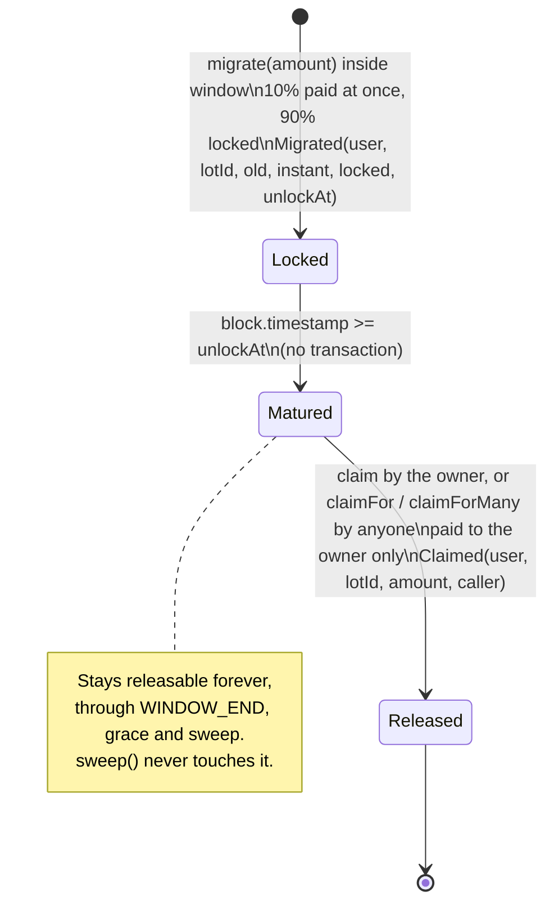

# Cojam token migration: contract specification

Status: draft for developer and auditor review, written 2026-11-12. The contracts are **not audited**. Code: [`contracts/`](../contracts/). How to build, test and deploy: [`contracts/README.md`](../contracts/README.md).

## 1. Overview

Cojam moves from the old CT token to a new, plain token on the same chain (Kaia mainnet, chain id 8217; testnet Kairos, chain id 1001).

| | Old token | New token |
| --- | --- | --- |
| Name, symbol | Cojam, CT | Cojam Token, CT |
| Address | `0x7f223b1607171b81ebd68d22f1ca79157fd4a44b` | set at deploy (created by the migration contract) |
| Decimals | 18 | 18 |
| Total supply | 4,083,262,533.9560001 CT (`4083262533956000100000000000` base units, read on chain 2026-11-12) | exactly the same number, fixed |
| Admin | owner `0xeb16…0518` (not controlled by the team) can pause, freeze and lock | none |

The migration rules, all enforced by code:

* **1:1.** One old base unit is credited as one new base unit. Same decimals, so there is no scaling.
* **10% now, 90% after 7 days.** On each `migrate(amount)` the contract credits the old CT that actually arrived. 10% of the credit (rounded down) is sent in new CT in the same transaction. The rest (credit minus the instant part, so no dust is lost) becomes a **lot** locked for 7 days.
* **Release without action from the holder.** After 7 days anyone may release a matured lot (`claimFor`, `claimForMany`); the tokens always go to the lot owner, never to the caller. The team runs a keeper bot that does this and pays the gas. Holders can also call `claim` themselves.
* **Window.** The window opens in the deploy block (`WINDOW_START = block.timestamp` at deploy) and closes at `WINDOW_END = WINDOW_START + 365 days` (exclusive). Releasing lots works forever.
* **Same rules for everyone.** No allowlist, no exclusions, no rewards, no bonus, no minimum.
* **No admin key.** Nothing is pausable, upgradeable or configurable after deploy. Nobody can move locked user funds, change the ratio, the 10% share or the lock.
* **Remainder.** After `WINDOW_END + grace`, anyone can call `sweep()`, which sends the new CT that no lot is owed to the treasury multisig fixed at deploy. Tokens owed to locked lots are never touched.

**Why the 7 day lock on 90%.** It deters swap abuse, such as swapping a large old balance and flipping the new supply on the market at once, and it favours real holders who intend to keep the token. Everyone gets 10% immediately, so the swap is usable at once, and the full amount always arrives after 7 days. The lock is a speed limit, not a ban: a holder can still sell 10% at once and the rest after a week, and the rule is identical for every address.

A note on the supply figure: the supply is usually quoted as 4,083,262,533.956 CT. The real on chain value carries one more digit, 0.0000001 CT (`100000000000` base units). The new token copies the on chain value to the last base unit, and the deploy reverts if the two ever differ. Site copy may keep the rounded figure but should not claim it is exact to the base unit.

## 2. Wallets and addresses

| Role | Address | Holds | Powers |
| --- | --- | --- | --- |
| **Token contract** (`CojamToken`) | created by the migration contract in its constructor | nothing of its own | none: no owner, no mint, no pause, no blacklist, no fee, no upgrade |
| **Swap contract** (`CojamMigration`) | set at deploy | the new CT reserve (the whole supply at deploy) and every old CT received through `migrate` | none: it only follows its code. No function can move old CT out. New CT leaves only as the 10% instant part (to the migrating address), as released lots (to the lot owner) and through `sweep` (to the treasury, only the unowed part, only after `WINDOW_END + grace`) |
| **Treasury multisig** | `TREASURY`, immutable, set at deploy | receives the unowed remainder after `WINDOW_END + grace` | none over the contracts. It is only a destination |
| **Deployer EOA** | any fresh key | gas only (KAIA). Holds no new CT after deploy: the deploy script checks this | none after the deploy transaction |
| **Keeper bot EOA** | any key run by the team | gas only (KAIA) | none. It calls `claimForMany` / `claimFor`, which can only pay lot owners. Anyone else may run the same calls |

* The treasury (issuance wallet) is a **brand new multisig created for the relaunch**, recommended as a Kaia Safe with a threshold such as 3 of 5 held by separate people and devices. It is not any wallet from the old Cojam project. The old owner `0xeb1622d0377da1f9815bfc6eff61afe3257a0518` is unrelated to the relaunch and must never be used as the treasury; the deploy script refuses it.
* The deployer is a single use key. It is not the treasury and it is never given any role, because the contracts have no roles.
* **No address can move locked user funds.** Not the deployer, not the treasury, not the keeper, not the team. A lot's new CT can only ever go to the address that created the lot.
* The old CT owner keeps its powers over old CT (section 6). It has no power over the new token or the swap contract.

## 3. Contracts and exact behaviour

Compiler: Solidity 0.8.28, optimizer on (200 runs), EVM target `paris` (no PUSH0, no transient storage, so the bytecode runs on every Kaia hardfork). Libraries: OpenZeppelin Contracts 5.4.0 (`ERC20`, `ERC20Permit`, `SafeERC20`, `SafeCast`, `ReentrancyGuard`).

### 3.1 `CojamToken`

* `ERC20("Cojam Token", "CT")` plus `ERC20Permit("Cojam Token")` (EIP-2612, domain version `"1"`).
* `TOTAL_SUPPLY = 4083262533956000100000000000` (constant).
* Constructor `(address recipient)`: mints `TOTAL_SUPPLY` to `recipient`. OpenZeppelin reverts on the zero address. There is no other mint path.
* Nothing else: no owner, no `burn`, no pause, no blacklist, no hooks, no fee, no proxy.

**KIP-7 compatibility.** Kaia runs the EVM, and Kaia wallets, Kaiascan and Kaia DEXs handle ERC-20 tokens natively, so the token works on Kaia as is. KIP-7 is Kaia's token standard: it is ERC-20 plus `safeTransfer` / `safeTransferFrom` with an `onKIP7Received` receiver callback, plus KIP-13 `supportsInterface`. Recommendation: **do not add KIP-7 extras and do not answer `supportsInterface` for KIP-7.** Answering `supportsInterface(0x65787371)` without the `safeTransfer` functions would be a false claim; adding them brings receiver callbacks (a re-entry surface) to a token whose value is being plain and neutral; and KIP-13 detection is not needed for ERC-20 style listing on Kaia. Pre launch action: confirm with each target exchange that an ERC-20 style token on Kaia is accepted (checklist item).

### 3.2 `CojamMigration`

**Constructor** `(IERC20 oldToken, address treasury, uint256 gracePeriod)`, in order:

1. Revert `ZeroAddress` if `oldToken` or `treasury` is zero.
2. Revert `GracePeriodTooLong` if `gracePeriod > 365 days` (catches unit mistakes).
3. Revert `DecimalsMismatch` unless `oldToken.decimals() == 18`.
4. Deploy `new CojamToken(address(this))`: the whole supply is minted to the swap in the same transaction. No other address ever holds it first, so there is no trust gap between token deploy and funding.
5. Revert `SupplyMismatch` unless `newToken.totalSupply() == oldToken.totalSupply()` at deploy time. Any old CT burn before deploy therefore stops the deploy, and the constant must be re-checked.
6. Store immutables: `OLD_TOKEN`, `NEW_TOKEN`, `TREASURY`, `WINDOW_START = block.timestamp`, `WINDOW_END = WINDOW_START + 365 days`, `SWEEP_OPENS_AT = WINDOW_END + gracePeriod`.

**`migrate(uint256 amount) returns (uint256 lotId)`**, `nonReentrant`:

1. Revert `ZeroAmount` if `amount == 0`; `WindowClosed` if `now >= WINDOW_END`.
2. Read the swap's old CT balance, call `OLD_TOKEN.safeTransferFrom(msg.sender, this, amount)`, read the balance again.
3. `received = after - before`. Revert `NothingReceived` if nothing arrived; revert `ReceivedMoreThanSent` if `received > amount`.
4. Revert `ReserveExhausted` if `received > availableReserve()`. With the supply check at deploy this cannot happen with the real old CT (it has no mint); it is a guard, not a policy.
5. `instant = received * 10 / 100` (rounded down); `locked = received - instant`. `locked` is always at least 1, and `instant + locked == received` exactly.
6. Append lot `{amount: locked, unlockAt: now + 7 days}` to `msg.sender`'s list; `lotId` is its index.
7. `totalMigrated += received; totalInstant += instant; totalOwed += locked`; emit `Migrated`.
8. Last step: if `instant > 0`, transfer `instant` new CT to `msg.sender`.

Rounding examples: 1 wei gives 0 now and 1 locked; 9 wei gives 0 and 9; 10 wei gives 1 and 9; 19 wei gives 1 and 18; 12,500 CT gives 1,250 CT and 11,250 CT. Old CT received stays in the swap contract forever (section 8.1).

**Release of matured lots.** All three entry points share one internal routine and are `nonReentrant`:

* `claim(uint256 maxLots)`: releases the caller's own lots to the caller.
* `claimFor(address user, uint256 maxLots)`: callable by anyone; releases `user`'s lots **to `user`**.
* `claimForMany(address[] users, uint256 maxLotsEach)`: callable by anyone; for each listed user, releases that user's lots **to that user**. Users with nothing matured are skipped; the call reverts `NothingToClaim` only if nothing at all was released.

The routine for one user: start at `nextClaimIndex[user]`, walk at most `maxLots` lots in id order, stop at the first lot with `now < unlockAt`, emit `Claimed(user, lotId, amount, msg.sender)` per lot, move the cursor, `totalOwed -= sum`, `totalClaimed += sum`, then transfer `sum` to `user`. `claim` and `claimFor` revert `NothingToClaim` if the sum is zero (no lots, none matured, or `maxLots == 0`).

No caller can choose the recipient: the recipient is always the lot owner, the address that called `migrate`. A third party can only make a matured payment arrive at its owner, never earlier and never elsewhere.

Why a cursor is correct: `LOCK_PERIOD` is a constant and block time never goes backwards, so a user's lots unlock in id order. A lot is released exactly when its id is below the cursor. The `maxLots` bound means a wallet with any number of lots can always be released in several transactions: no unbounded loop can brick a user. Measured: 25 lots in one call cost 212,514 gas.

**`sweep() returns (uint256 amount)`**, `nonReentrant`, callable by anyone:

1. Revert `SweepNotOpen` if `now < SWEEP_OPENS_AT`.
2. `amount = availableReserve() = NEW_TOKEN.balanceOf(this) - totalOwed`. Revert `NothingToSweep` if zero.
3. `totalSwept += amount`; emit `Swept(TREASURY, amount)`; transfer `amount` to `TREASURY`.

It can be called again later (for example if someone sends new CT to the contract by mistake). It can never reduce the balance below `totalOwed`, because `migrate` is closed after `WINDOW_END` and so `totalOwed` can only go down.

**Views**: `availableReserve()`, `isOpen()`, `previewSplit(received) → (instant, locked)`, `lotCount(user)`, `lotOf(user, lotId) → (amount, unlockAt, claimed)` (amount is the locked 90% part), `claimable(user, maxLots) → (amount, lots)`, `pendingOf(user)` (all unreleased, matured or not; loops, view only), public counters `totalMigrated`, `totalInstant`, `totalOwed`, `totalClaimed`, `totalSwept`, `nextClaimIndex(user)`, constants `WINDOW`, `LOCK_PERIOD`, `INSTANT_PERCENT`, and the immutables.

**Invariants** (checked after every step of the fuzz tests):

* `NEW_TOKEN.balanceOf(swap) >= totalOwed` (the swap always holds at least the sum of unreleased locked amounts)
* `totalOwed == sum of unreleased lot amounts`
* `NEW_TOKEN.balanceOf(swap) + totalInstant + totalClaimed + totalSwept == TOTAL_SUPPLY`
* `totalMigrated == totalInstant + totalOwed + totalClaimed`
* `OLD_TOKEN.balanceOf(swap) >= totalMigrated` (equal unless someone sent old CT directly)
* every address holds exactly its instant parts plus its released lots; a keeper or any third party caller never receives anything

## 4. Parameters

| Parameter | Value | Where set | Changeable |
| --- | --- | --- | --- |
| Ratio | 1:1 (base unit for base unit) | code | no |
| Instant share | 10%, rounded down | `INSTANT_PERCENT` constant | no |
| Lock on the rest | 7 days (604,800 s) | `LOCK_PERIOD` constant | no |
| Decimals | 18 and 18 | code, checked at deploy | no |
| New supply | 4,083,262,533.9560001 CT | `CojamToken.TOTAL_SUPPLY`, checked against old supply at deploy | no |
| Window start | the deploy block's timestamp | constructor (`block.timestamp`) | no |
| Window length | 365 days | `WINDOW` constant | no |
| Grace period | recommended 30 days, max 365 | constructor | no |
| `TREASURY` | new relaunch Safe multisig | constructor | no |
| Old token | `0x7f223b1607171b81ebd68d22f1ca79157fd4a44b` | constructor | no |

## 5. Lot state diagram

Contract phases: window `[WINDOW_START, WINDOW_END)` (migrate and release), after `WINDOW_END` (release only), from `SWEEP_OPENS_AT` (release and sweep).

## 6. What the old token can do (read from chain)

The old contract's source is not verified by us. A scan of its deployed bytecode on 2026-11-12 found these owner functions: `pause()`, `unPause()`, `freeze(address)`, `unFreeze(address)`, lock functions (`unlock(address,uint256)`, `unlockAll(address)`, `releaseLock(address)`, `lockInfo(address,uint256)`, `totalLocked(address)`, plus three selectors we could not name), `transferOwnership`, `renounceOwnership`. It has `burn` and `burnFrom`. It has **no** `mint`, no `permit`, no KIP-7 `safeTransfer`, no `supportsInterface`. On chain: owner `0xeb1622d0377da1f9815bfc6eff61afe3257a0518`, `paused() == false`, balances mapping at storage slot 1.

Fork tests against the real bytecode confirmed: `pause()` blocks `transferFrom` (so `migrate` reverts) but releases of existing lots keep paying; `freeze(holder)` blocks that holder from migrating; `freeze(swapContract)` does **not** block migrate or release, because the swap never sends old CT.

## 7. Events and errors

**Events**

| Event | When |
| --- | --- |
| `Migrated(address indexed user, uint256 indexed lotId, uint256 oldAmount, uint256 instantAmount, uint256 lockedAmount, uint256 unlockAt)` | each successful `migrate`. `oldAmount` is what actually arrived; `instantAmount + lockedAmount == oldAmount` |
| `Claimed(address indexed user, uint256 indexed lotId, uint256 amount, address indexed caller)` | once per lot released. `user` received the tokens; `caller` sent the transaction (the owner, the keeper or anyone) |
| `Swept(address indexed to, uint256 amount)` | each successful `sweep` |

Plus the standard ERC-20 `Transfer` and `Approval` on both tokens. A front end can rebuild a wallet's full history from `Migrated` and `Claimed` filtered by `user`. The keeper finds due lots from `Migrated.unlockAt` and the user's `nextClaimIndex`.

**Custom errors**

| Error | Raised by | Meaning |
| --- | --- | --- |
| `ZeroAddress` | constructor | old token or treasury is zero |
| `GracePeriodTooLong` | constructor | grace above 365 days |
| `DecimalsMismatch` | constructor | old or new token is not 18 decimals |
| `SupplyMismatch` | constructor | new supply differs from the old `totalSupply()` |
| `ZeroAmount` | migrate | amount is zero |
| `WindowClosed` | migrate | at or after `WINDOW_END` |
| `NothingReceived` | migrate | the transfer moved no old CT into the swap |
| `ReceivedMoreThanSent` | migrate | more arrived than `amount` (non standard token) |
| `ReserveExhausted` | migrate | not enough unowed new CT (unreachable with real old CT) |
| `NothingToClaim` | claim, claimFor, claimForMany | no matured unreleased lot within `maxLots` (for the batch: for every listed user) |
| `SweepNotOpen` | sweep | before `SWEEP_OPENS_AT` |
| `NothingToSweep` | sweep | every new CT in the swap is owed to lots |
| `ReentrancyGuardReentrantCall` | every state changing function (OpenZeppelin) | re-entry attempt |

Errors coming from old CT itself (allowance, balance, paused, frozen) bubble up unchanged through `SafeERC20`. The front end should map them to the states in HANDOFF 4.4 (approval needed, insufficient balance, old token paused).

## 8. Design decisions and reasons

### 8.1 Received old CT stays in the swap contract (not `0x…dEaD`, not `burnFrom`)

* **Freeze risk decides it.** The old owner can `freeze` any address, and a frozen address cannot send. A design that forwards old CT to `0x…dEaD` inside `migrate` would be bricked for everyone by one `freeze(swap)` call. Holding in place cannot be blocked that way (proved on the fork).
* **`burnFrom` is unwise here.** Its behaviour inside unverified code (allowance handling, interaction with pause, freeze and locks, events) is not something we control, and it still needs the same approval. It would also make the received amount harder to measure and shrink the old `totalSupply`, which removes a clean cross check.
* **It is as good as burned.** The swap has no function that can move old CT, and no admin or upgrade path. `OLD_TOKEN.balanceOf(swap)` is a public, exact ledger of everything migrated. Supply trackers can treat that address as locked forever.
* **Cheaper.** One old CT transfer per migrate instead of two.

### 8.2 No admin key

The contracts have no owner, no pause, no upgrade, no parameter setters. The only privileged outcome (the remainder going to the treasury) is time gated, permissionless to trigger and limited to unowed tokens. This removes the most common migration failure modes (key theft, insider moves, ratio changes) and keeps the new token listing neutral.

The cost is that nothing can be stopped if a bug appears after launch. Mitigations: external audit, full testnet run, a small mainnet dry run with team wallets, and a contract small enough to review line by line (about 300 lines). The worst case of a swap bug is bounded by what it holds: old CT already migrated, and new CT not yet released.

**Alternative (not built): multisig plus timelock.** If the founder or auditor wants an emergency brake, add a `pauseMigrate` role held by a Safe behind a timelock (for example 48 hours). It may pause **only** `migrate`, never releases or `sweep`, and may never move tokens, change the ratio, the 10% share, the lock, the window or the treasury. HANDOFF 4.2 lists more admin powers (top up, recover other tokens); none are needed here because the reserve is the full supply from block one.

### 8.3 Token deployed by the swap, window opened by the deploy

The swap's constructor creates `CojamToken(address(this))`. The supply exists only inside the swap from the first block, and the deployer never holds any. The supply and decimals cross checks run in the same transaction. The window opens in that same block, so the mainnet deploy **is** the launch: the swap address is unknown until then, and anyone who finds the contract can migrate at once under the same rules. Deploy only when the announcement, site and keeper are ready.

### 8.4 Permissionless release for the keeper

The founder wants the 90% to arrive without the holder doing anything. `claimFor` and `claimForMany` make release a public service with one hard rule: the payee is always the lot owner. Consequences:

* The team's keeper bot needs no privileges, holds only gas, and its key being stolen changes nothing (an attacker could only pay holders on time).
* If the keeper stops, any holder can `claim`, and anyone (an exchange, a community member) can run the same keeper.
* A third party cannot release early (the unlock check is the same), cannot redirect (no recipient parameter), and cannot skip or reorder lots (the cursor only moves over matured lots).
* The only effect a stranger can have is to make matured tokens arrive in the owner's wallet, which is what the owner was promised.

### 8.5 Measured credit

The credit is the swap's balance change, not the requested amount, and the 10/90 split is applied to that credit. Fee on transfer or other non standard behaviour can never over credit (tested with a 1% fee mock and in fuzz runs with a 0.37% fee). The real CT has no fee (fork test: credit equals amount).

### 8.6 Checks, effects, interactions

Releases and `sweep` follow checks, effects, interactions strictly (state first, transfer last). `migrate` must call old CT before writing state, because the credit is the measured balance change; after that it writes all state and emits, and the instant new CT transfer is the last step. This is the standard pattern for measured transfers; `nonReentrant` on every state changing function closes the gap, and the old token is a fixed, known contract, not user input. Tests show a malicious token that re-enters `migrate`, `claim`, `claimFor`, `claimForMany` or `sweep` from inside `transferFrom` is rejected, and a swallowed re-entry gains nothing.

### 8.7 No permit based migrate

Old CT has no `permit` (EIP-2612), so a one signature migrate is impossible. Holders send two transactions: approve, then migrate. Contract wallets such as Safe can batch both atomically (MultiSend), which is tested. The front end should approve the exact amount, not an unlimited allowance. The new token does support `permit`, for later DEX and app use.

### 8.8 Lots and cursor releases

Each `migrate` call is its own lot with its own 7 day timer. A cursor per user plus a `maxLots` bound gives constant cost per lot, no unbounded loops, and no per lot flag to store. Only the caller can create lots for itself, so lot spam only affects the spammer, and even then it is just more release transactions (which the keeper or the spammer pays for).

### 8.9 Kaia specifics

* Kaia fee delegated transactions work: `msg.sender` is the sender, not the fee payer, so a sponsored gas flow does not change who owns a lot.
* Kaia account key changes (role based keys) do not affect ownership: lots are keyed by address.
* Hardhat needs a hardfork history entry to fork chain 8217 (`hardhat.config.js`).

## 9. Edge case policies

| Case | Policy |
| --- | --- |
| **Tokens on exchanges** (MEXC, any Korean exchange still holding CT) | The holder of record is the exchange. The exchange migrates its own balance through the same contract (it is a normal caller): it receives 10% at once and the rest after 7 days, released by the keeper. It credits its users by its own process. Publish the list of supporting exchanges and their dates. No special contract path. |
| **Klayswap LP** | LP tokens are not old CT. Holders remove liquidity first, then migrate the returned CT. Show an inline hint on the migrate page. |
| **Vesting or locked contracts** | A contract holding old CT can migrate only if it can call `approve` and `migrate` on arbitrary targets. Release needs nothing from it (the keeper or anyone calls `claimFor`). If it cannot call `migrate`, its beneficiaries must get the CT out first. There is no admin path, by design. Ask known vesting holders before launch. |
| **Contract wallets (Safe, multisig)** | Fully supported. No `tx.origin`, no EOA checks; lots belong to `msg.sender`. Approve and migrate can be one batched Safe transaction, and the 90% arrives without another Safe transaction. Tested with a contract wallet mock; test a real Safe on Kairos before launch. |
| **Lost keys** | Old CT in a lost wallet cannot be migrated by anyone. After `WINDOW_END + grace`, its matching share of new CT is part of the remainder that goes to the treasury. Any later compensation is an off chain treasury policy. |
| **Lost keys after migrating** | The lot is still released, but only to that address. Nobody can redirect it. |
| **Late migrators** | `migrate` reverts from `WINDOW_END`. The late policy (if any) is paid by the treasury from the swept remainder, off chain. Show the deadline everywhere. Open decision. |
| **Tiny balances** | No minimum. Any amount from 1 base unit migrates exactly. Below 10 base units the instant part rounds to 0 and the whole amount is locked; nothing is lost. The "Max" button should send the whole balance. |
| **Old CT paused by the unknown owner** | `migrate` reverts for everyone while paused; existing lots keep unlocking and being released. Fallback: take a snapshot of old CT balances at the pause block (balances cannot change while paused, so anyone can verify it) and publish a Merkle root. Funding: the swap has no admin, so the unmigrated reserve stays inside until `WINDOW_END + grace`, then goes to the treasury, which funds a Merkle claim contract for the snapshot. Cost of this design: the fallback can only pay out after `SWEEP_OPENS_AT`. Mitigation before launch: find the old owner and ask for `renounceOwnership()` (removes pause and freeze for good), or accept the risk explicitly. |
| **Holder frozen or locked by the old owner** | That holder (or that locked part) cannot migrate. Same fallback as a pause: evidence on chain, treasury funded claim after `SWEEP_OPENS_AT`. |
| **Old CT still transferable and trading** | Old CT keeps trading after launch and after `WINDOW_END`. Warn on the site against buying old CT late; show the deadline and the full old and new addresses everywhere (the ticker CT is reused by other tokens on MEXC). |
| **Old CT sent directly to the swap** (plain `transfer`, not `migrate`) | Not credited and cannot be recovered: no function moves old CT. The transfer is visible on chain (a `Transfer` to the swap without a `Migrated`), so the treasury may compensate off chain. FAQ warns: never send CT to the contract, always use the migrate page. |
| **New CT or other tokens sent to the swap** | New CT becomes part of the remainder and is swept to the treasury. Any other token is stuck forever (no rescue function, by design). |
| **Keeper down or late** | Nothing is lost. Holders see a "Release now" button that calls `claim`; anyone can call `claimFor`. |
| **Unidentified large wallets** (top 10 hold about 65.6%) | Treated like everyone else. The contract has no exclusion list. The 7 day lock on 90% limits how fast a large migrated balance can reach the market. |

## 10. Security considerations

* **Trust model.** No key controls the new token or the swap. The remaining trust points are: the deployed bytecode (audit and verify on Kaiascan), the treasury multisig (only receives the remainder), the keeper (no power; liveness only) and the old CT owner (can pause, freeze or lock old CT; cannot touch new CT or lots).
* **Supply and backing.** New supply equals old supply at deploy and old CT has no mint, so the reserve can always back every migrate. Locked lots are always fully backed (first invariant). `sweep` is mathematically limited to `balance - totalOwed`.
* **No redirection.** No function takes a recipient. The 10% goes to `msg.sender` of `migrate`; released lots go to the lot owner; the remainder goes to the immutable treasury.
* **Re-entrancy.** `nonReentrant` on `migrate`, `claim`, `claimFor`, `claimForMany`, `sweep`. The new token has no hooks. The old token is fixed.
* **Integer bounds.** Lot amounts are stored as `uint128` and unlock times as `uint64`, both through `SafeCast`. The supply is below 2^92, so `received * 10` cannot overflow.
* **Time.** Only `block.timestamp` comparisons with day scale margins; a validator's few seconds of drift do not matter.
* **Front running.** Nothing to front run: no price, no shared queue, no first come limit (the reserve covers the whole supply). Front running a keeper's release only pays the same owner the same amount.
* **Phishing.** The main real world risk. Publish one official URL and the three addresses (old CT, new CT, swap) everywhere; never ask users to send tokens anywhere; the site never holds funds.
* **Approvals.** Encourage exact approvals. A leftover allowance to the swap is harmless (the swap only pulls on the owner's own `migrate` call), but exact is better hygiene.
* **Not audited.** Never describe these contracts as audited until an external report is published and linked.

## 11. Gas notes

Measured on the Hardhat network (`npm run gas`, solc 0.8.28, optimizer 200 runs):

| Action | Gas |
| --- | --- |
| Deploy `CojamMigration` (includes creating `CojamToken`) | about 2,143,100 |
| `migrate` (includes the instant transfer; first lot of a wallet costs more) | 97,871 to 219,819, average 140,031 |
| `claim`, 1 lot | about 57,700 |
| `claim`, 25 lots | 212,514 |
| `claimFor` | 70,413 to 178,768 |
| `claimForMany` (2 to 3 users) | 99,561 to 144,996 |
| `sweep` | 49,414 to 83,614 |
| Old CT `approve` | about 46,000 |

Each extra lot in one release costs about 6,500 gas (one cold storage read plus one event). The keeper should batch users with `claimForMany` and keep each transaction to a few hundred lots; the front end can read `claimable(user, 100)` first. Costs in KAIA depend on the base fee at the time.

## 12. Test plan and results

Command: `cd contracts && npm install && npm test`. Run on 2026-11-12, Node 22, Hardhat 2.28.6, OpenZeppelin 5.4.0. Result: **44 passing, 0 failing** (33 unit, 5 fork against Kaia mainnet, 6 fuzz). Long fuzz campaign `npm run test:fuzz` (24 seeds by 200 steps): **24 passing, 0 failing**. With `SKIP_FORK=1`: 39 passing, 5 pending (the fork tests skip cleanly).

| # | Test | Status |
| --- | --- | --- |
| 1 | New supply equals the old on chain supply exactly (4,083,262,533.9560001 CT) | Pass |
| 2 | Whole supply held by the swap at deploy; deployer holds none | Pass |
| 3 | Standard metadata; no owner, mint, pause, blacklist, freeze, upgrade, burn | Pass |
| 4 | EIP-2612 permit works | Pass |
| 5 | Window opens at deploy (`WINDOW_START` = deploy block time); end, grace, addresses, constants | Pass |
| 6 | Constructor guards: zero addresses, grace too long, wrong decimals, supply mismatch, old burn before deploy | Pass |
| 7 | 1:1 swap: 10% lands in the same transaction, 90% becomes a 7 day lot, old CT kept, `Migrated` event | Pass |
| 8 | 10% math and rounding: 1, 9, 10, 11, 19, 99, 100 wei, an odd 21 digit amount, the full balance; `instant + locked == credit`; `previewSplit` | Pass |
| 9 | Zero amount reverts | Pass |
| 10 | No approval and over balance revert | Pass |
| 11 | Window edges: open in the blocks right after deploy, end minus 1 works, end reverts | Pass |
| 12 | Old token paused: migrate reverts with no state change and no payout; works after unpause | Pass |
| 13 | Frozen holder cannot migrate; freezing the swap changes nothing | Pass |
| 14 | Fee on transfer old token: credit and split use only what arrived | Pass |
| 15 | Inflating or lying token rejected | Pass |
| 16 | `ReserveExhausted` guard | Pass |
| 17 | Lock edges: unlock minus 1 reverts, unlock pays the 90%, total equals the credit | Pass |
| 18 | `claimFor` by a stranger pays the owner, caller gets nothing, `Claimed` names the caller | Pass |
| 19 | Nobody can redirect or take another user's lots (claim, claimFor, claimForMany with duplicates) | Pass |
| 20 | `claimForMany` pays several owners and skips locked ones; reverts only if nothing at all | Pass |
| 21 | Multiple lots, partial releases, `maxLots` bound, views | Pass |
| 22 | Release after the window, after sweep, five years later | Pass |
| 23 | 60 lots released in bounded chunks (gas recorded) | Pass |
| 24 | Sweep closed until `WINDOW_END + grace`; sends only the unowed remainder; locked remainders stay whole and pay | Pass |
| 25 | New CT sent later is swept; never below what is owed | Pass |
| 26 | Nothing to sweep when every remaining token is owed | Pass |
| 27 to 31 | Re-entry into migrate, claim, sweep, claimFor, claimForMany from a malicious token is rejected | Pass |
| 32 | Swallowed re-entry gains nothing, accounting exact | Pass |
| 33 | Contract wallet: batched approve plus migrate, 10% at once, keeper releases 90%; lots keyed by `msg.sender` | Pass |
| 34 | Fork: live old CT name, symbol, decimals, exact supply, owner, not paused | Pass |
| 35 | Fork: deploy against real old CT (guards pass) | Pass |
| 36 | Fork: real old CT migrates 1:1 with no fee; 10% at once; keeper releases 90% after 7 days | Pass |
| 37 | Fork: real `pause()` blocks migrate, existing lots still release, `unPause()` restores | Pass |
| 38 | Fork: real `freeze()` blocks a holder; freezing the swap blocks nothing | Pass |
| 39 to 44 | Fuzz: 6 seeds by 160 steps (2 with a fee token). Random amounts (0, 1 wei, 9 wei, full, over balance, random) and timing (exact unlock and unlock minus 1 included); releases by the owner, by a keeper, by other users and in batches with duplicates; checked against a model; every invariant of section 3.2 after every step; final keeper drain leaves the swap at zero, the keeper with nothing, the treasury with exactly `supply - migrated`, and users holding exactly what they migrated | Pass |

Still to do before mainnet: external audit; Kairos end to end with the real front end, the keeper bot and a real Safe; a small mainnet dry run with team wallets right after the launch deploy.

## 13. Launch checklist (HANDOFF 4.7 adapted)

1. External audit report published and linked on the site. Audit status stated honestly until then.
2. Treasury: new Kaia Safe created for the relaunch, signers and threshold documented, address published. Not any old Cojam wallet.
3. Old token: try to reach the old owner `0xeb16…0518`; ask for `renounceOwnership()`. If not possible, publish the pause and freeze risk and the fallback policy.
4. Re-read the old `totalSupply()` right before deploy; it must equal `CojamToken.TOTAL_SUPPLY` (the deploy reverts otherwise).
5. Kairos rehearsal: deploy with the script, migrate from an EOA and a Safe, run the keeper against it, run through every front end state in HANDOFF 4.4.
6. Keeper bot ready before mainnet deploy: watches `Migrated`, calls `claimForMany` after each `unlockAt`, alerts when its gas balance is low.
7. Everything ready at once, because the deploy opens the window: site, announcement, keeper, dashboard, FAQ.
8. Mainnet deploy from a fresh EOA; record `WINDOW_START`, `WINDOW_END`, `SWEEP_OPENS_AT` and show them as human dates; verify `CojamMigration` and `CojamToken` source on Kaiascan; confirm on chain that the swap holds the whole supply and the deployer holds none.
9. Small mainnet dry run with team wallets inside the live window (migrate, check the 10%, keeper releases the 90% after 7 days).
10. Exchanges contacted (ERC-20 style token on Kaia accepted, swap support and dates); list published.
11. Announcement with the three full addresses on every official channel, plus the official URL and the "we never ask you to send tokens" banner.
12. Public dashboard from chain data: `totalMigrated`, `totalInstant`, `totalOwed`, `totalClaimed`, `availableReserve`, old CT held by the swap, days left, upcoming unlocks.
13. Monitoring and alerts on `Migrated`, `Claimed`, `Swept`, on the reserve, on overdue matured lots (keeper health), and on old CT `paused()` and freeze activity.
14. Incident runbook: there is no pause to press. The runbook covers old CT being paused or frozen (snapshot block, announcement, fallback timeline), a keeper outage (announce "Release now", restart), phishing sites, and a found bug (announce, stop promoting the page, plan a replacement funded by the treasury after `SWEEP_OPENS_AT`).
15. Support FAQ live: exchanges, Klayswap LP, vesting and contract wallets, lost keys, why 10% now and 90% after 7 days, never send CT directly to the contract.

## 14. Open decisions

* **Launch date**, which is the mainnet deploy date (the window opens in the deploy block).
* **Grace period** length (recommended 30 days; any value up to 365).
* **Late migration policy** after `WINDOW_END`, and how a pause or freeze fallback is paid from the swept remainder.
* **Emergency brake**: ship with no admin (current code) or add the narrow migrate only pause behind a Safe and timelock (section 8.2). Recommendation: no admin, plus audit and dry runs.
* **Exchange support** list and dates.
