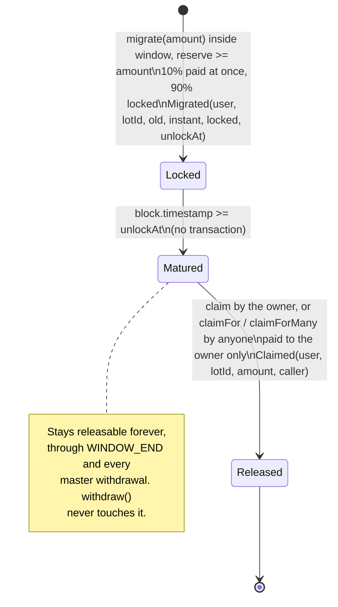

# Cojam token migration: contract specification

Status: draft for developer and auditor review. First written 2026-11-12; revised 2026-11-14 for the founder's issuance model: the whole supply is minted to a master wallet (an ordinary EOA, by the founder's choice), the master funds the swap by plain transfers and may withdraw the unowed reserve at any time, and nothing else is privileged. Revised again on 2026-11-14 for the founder's tokenomics: a fixed new supply of 2,000,000,000 CT and a swap ratio of 0.4 new CT per old CT. The contracts are **not audited**. Code: [`contracts/`](../contracts/). How to build, test and deploy: [`contracts/README.md`](../contracts/README.md).

## 1. Overview

Cojam moves from the old CT token to a new, plain token on the same chain (Kaia mainnet, chain id 8217; testnet Kairos, chain id 1001).

| | Old token | New token |
| --- | --- | --- |
| Name, symbol | Cojam, CT | Cojam Token, CT |
| Address | `0x7f223b1607171b81ebd68d22f1ca79157fd4a44b` | set at deploy (deployed on its own, before the swap contract) |
| Decimals | 18 | 18 |
| Total supply | 4,083,262,533.9560001 CT after burns (`4083262533956000100000000000` base units, read on chain 2026-11-12); 5,000,000,000 CT before burns | exactly 2,000,000,000 CT (`2000000000000000000000000000` base units), fixed, minted once to the master wallet |
| Admin | owner `0xeb16…0518` (not controlled by the team) can pause, freeze and lock | none |

The migration rules, all enforced by code:

* **0.4 new CT per old CT.** The ratio is set against the pre burn old supply: 5,000,000,000 old CT map to the 2,000,000,000 new CT, so the credit is `received * 2 / 5` (constants `RATIO_NUM = 2`, `RATIO_DEN = 5`), rounded down to the base unit. 10 old CT give 4 new CT. Both tokens have 18 decimals, so the ratio applies to base units directly. The whole current old supply needs about 1,633,305,013.58 new CT, which is under the 2B supply.
* **10% now, 90% after 7 days.** On each `migrate(amount)` the contract measures the old CT that actually arrived and computes the credit. 10% of the credit (rounded down) is sent in new CT in the same transaction. The rest (credit minus the instant part, so no dust is lost) becomes a **lot** locked for 7 days. For 10 old CT: 0.4 new CT at once, 3.6 after 7 days.
* **Release without action from the holder.** After 7 days anyone may release a matured lot (`claimFor`, `claimForMany`); the tokens always go to the lot owner, never to the caller. The team's gas wallet does this as a keeper and pays the gas. Holders can also call `claim` themselves.
* **Window.** The window opens in the swap contract's deploy block (`WINDOW_START = block.timestamp` at deploy) and closes at `WINDOW_END = WINDOW_START + 365 days` (exclusive). Releasing lots works forever.
* **Gasless for holders.** Through Kaia native fee delegation, the Cojam gas wallet co-signs and pays the gas for approve, migrate and claims. The holder still signs every transaction, so `msg.sender` is always the holder (section 3).
* **Same rules for everyone.** No allowlist, no exclusions, no rewards, no bonus. The only minimum is technical: 1 or 2 old base units credit 0 new base units, so `migrate` reverts `AmountTooSmall` for them.
* **Funded by the master wallet.** The whole new supply is minted to the founder's master wallet. The master sends new CT to the swap contract with plain transfers, as much and as often as the plan says. A swap only succeeds while the contract holds enough new CT that no earlier lot is owed (the **reserve**).
* **One narrow privilege: the master's withdraw.** The master wallet fixed at deploy can call `withdraw(amount)` at any time, during or after the window, to take back new CT that no lot is owed (at most `availableReserve()`); the tokens always go to the master. That is the only privileged function. Neither contract has an owner, a pause, a setter, a rescue function or an upgrade path. Nobody, the master included, can move locked user funds or old CT, or change the ratio, the 10% share, the lock or the window.
* **Remainder.** Whatever is not swapped is withdrawn by the master whenever it decides; there is no automatic sweep.

**Why the 7 day lock on 90%.** It deters swap abuse, such as swapping a large old balance and flipping the new supply on the market at once, and it favours real holders who intend to keep the token. Everyone gets 10% immediately, so the swap is usable at once, and the full amount always arrives after 7 days. The lock is a speed limit, not a ban: a holder can still sell 10% at once and the rest after a week, and the rule is identical for every address.

A note on the supply figures: the old supply is usually quoted as 4,083,262,533.956 CT; the real on chain value carries one more digit, 0.0000001 CT (`100000000000` base units). The new supply is a round 2,000,000,000 CT. The 2,000,000,000 minus whatever is credited to swaps stays with the master (in its wallet or in the swap reserve, from which it can withdraw).

## 2. Wallets and addresses

| Role | Address | Holds | Powers |
| --- | --- | --- | --- |
| **Token contract** (`CojamToken`) | set at deploy | nothing of its own | none: no owner, no mint, no pause, no blacklist, no fee, no upgrade |
| **Swap contract** (`CojamMigration`) | set at deploy | the new CT the master sent (the reserve plus what lots are owed) and every old CT received through `migrate` | none: it only follows its code. No function can move old CT out. New CT leaves only as the 10% instant part (to the migrating address), as released lots (to the lot owner), and through `withdraw` (to `MASTER`, only the unowed part) |
| **Master wallet** | `MASTER_ADDRESS`: the `CojamToken` constructor argument and the immutable `MASTER` of the swap | the whole new supply at deploy; afterwards whatever it has not sent to the swap, plus anything it withdrew | one: `withdraw(amount)` on the swap, capped at the unowed reserve, paid to itself. It funds the swap by plain transfers |
| **Deployer EOA** | any fresh key | gas only (KAIA). Holds no new CT after deploy unless it is itself the master: the deploy script checks this | none after the deploy transactions |
| **Gas wallet** (fee payer and keeper) | one hot EOA run by the team | KAIA only, low balance, topped up by the team | none over tokens. As **fee payer** it co-signs holders' fee delegated transactions and pays their gas. As **keeper** it calls `claimForMany` / `claimFor` after unlock, which can only pay lot owners. Anyone else may run the same keeper calls |

* The master wallet is the founder's and, **by the founder's choice, an ordinary EOA** (not a Safe). It is not any wallet from the old Cojam project. The old owner `0xeb1622d0377da1f9815bfc6eff61afe3257a0518` is unrelated to the relaunch and must never be the master: the swap constructor reverts `OldOwnerNotAllowed` and the deploy script refuses it too.
* The master holds most of the new supply and can withdraw the swap's unowed reserve. It is the highest value key of the relaunch and a single key: keep it offline (hardware wallet), never on a server, never in the fee payer or keeper, never shared. Its power over the swap is limited to the unowed reserve; it cannot touch lots or old CT.
* The deployer is a single use key. On testnet it may be the master (so the script can fund the swap in one go). On mainnet it should not be: the master should receive the supply directly.
* The gas wallet is a hot key by necessity (it signs automatically). Keep only a few days of gas in it. If it is stolen, the thief can spend that KAIA and nothing else: it holds no tokens and has no role in either contract. Rotating it needs no contract change, only a new key in the fee payer and keeper services. It is never the master.
* **No address can move locked user funds.** Not the master, not the deployer, not the gas wallet, not the team. A lot's new CT can only ever go to the address that created the lot, and `withdraw` is capped at the unowed balance.
* The old CT owner keeps its powers over old CT (section 7). It has no power over the new token or the swap contract.

## 3. Fee delegation (gasless swaps)

Holders swap without owning KAIA. Kaia supports fee delegation natively at the transaction level, so **no contract change is needed** and none was made.

**Transaction types.** Kaia has its own fee delegated transaction types next to the Ethereum ones: `TxTypeFeeDelegatedSmartContractExecution` (type `0x31`, the fee payer pays all of the gas) and `TxTypeFeeDelegatedSmartContractExecutionWithRatio` (type `0x32`, the fee payer pays a set percentage). Approve, migrate and claim are all smart contract executions, so they use `0x31`. They are sent with `kaia_sendRawTransaction` (Kaia SDKs such as `@kaiachain/ethers-ext` build and sign them). Wallets that only know Ethereum transaction types cannot sign them; those users send a normal transaction and pay their own gas, which always works.

**Signing order.**

1. The front end builds the transaction (`from` = holder, `to`, `data`, gas, nonce) and the holder signs it in their wallet. The sender signature covers `to`, `data`, value, nonce and gas.
2. The holder's signed transaction goes to the Cojam fee payer service. The gas wallet adds itself as fee payer and signs.
3. The fully signed transaction is broadcast. The network charges the gas to the fee payer.

**What it changes on chain: nothing that matters to the contracts.** `msg.sender` is the holder, not the fee payer, and so is `tx.origin`. Lots, the 10% payout and releases are keyed to the holder exactly as with a normal transaction. Neither contract reads `tx.origin` or the fee payer: a scan of the compiled bytecode of `CojamMigration` and `CojamToken` (re-checked 2026-11-14), and of the deployed old CT, finds no `ORIGIN` opcode, and the source never mentions it. The fork and unit tests therefore cover fee delegated calls as well.

**What the fee payer can and cannot do.**

* It only pays gas. It cannot change the holder's transaction (the sender signature covers every field), cannot move tokens, cannot redirect a payout, and has no role in either contract.
* It can refuse to sign. That only removes the free gas; the holder can still send the same call as a normal transaction.
* It can be drained of KAIA by abuse, so the fee payer service only co-signs these calls: `approve(swap, amount)` on old CT, and `migrate(amount)`, `claim(maxLots)`, `claimFor(user, maxLots)` and `claimForMany(users, maxLotsEach)` on the swap. It checks the target address, the function selector and the approve spender, caps the gas limit and the batch size, and rate limits per sender address. The master's `withdraw` is never sponsored: the master pays its own gas. See `docs/FEE-DELEGATION.md` section 3.

**Approve needs its own transaction.** Old CT has no `permit` (EIP-2612), so there is no single signature approve plus migrate. A first time holder signs two fee delegated transactions: `approve` on old CT, then `migrate` on the swap. Holders who already approved enough skip the first one.

**Release after 7 days.** The same gas wallet acts as keeper and calls `claimForMany` for matured lots with its own ordinary transactions. The holder signs nothing for the 90% to arrive. A holder who wants it sooner after unlock can still send `claim`, sponsored or not.

**Contract wallets.** A Safe's transaction is submitted by one of its owner EOAs; that EOA's transaction may itself be fee delegated. The swap still sees the Safe as `msg.sender`.

## 4. Contracts and exact behaviour

Compiler: Solidity 0.8.28, optimizer on (200 runs), EVM target `paris` (no PUSH0, no transient storage, so the bytecode runs on every Kaia hardfork). Libraries: OpenZeppelin Contracts 5.4.0 (`ERC20`, `ERC20Permit`, `SafeERC20`, `SafeCast`, `ReentrancyGuard`).

### 4.1 `CojamToken`

* `ERC20("Cojam Token", "CT")` plus `ERC20Permit("Cojam Token")` (EIP-2612, domain version `"1"`).
* `TOTAL_SUPPLY = 2_000_000_000 * 10**18` (constant): exactly 2,000,000,000 CT.
* Constructor `(address master)`: mints `TOTAL_SUPPLY` to `master`. OpenZeppelin reverts `ERC20InvalidReceiver(address(0))` on the zero address. There is no other mint path.
* Deployed on its own, before the swap contract. It does not know the swap contract.
* Nothing else: no owner, no `burn`, no pause, no blacklist, no hooks, no fee, no proxy.

**KIP-7 compatibility.** Kaia runs the EVM, and Kaia wallets, Kaiascan and Kaia DEXs handle ERC-20 tokens natively, so the token works on Kaia as is. KIP-7 is Kaia's token standard: it is ERC-20 plus `safeTransfer` / `safeTransferFrom` with an `onKIP7Received` receiver callback, plus KIP-13 `supportsInterface`. Recommendation: **do not add KIP-7 extras and do not answer `supportsInterface` for KIP-7.** Answering `supportsInterface(0x65787371)` without the `safeTransfer` functions would be a false claim; adding them brings receiver callbacks (a re-entry surface) to a token whose value is being plain and neutral; and KIP-13 detection is not needed for ERC-20 style listing on Kaia. Pre launch action: confirm with each target exchange that an ERC-20 style token on Kaia is accepted (checklist item).

### 4.2 `CojamMigration`

**Constructor** `(IERC20 oldToken, IERC20 newToken, address master)`, in order:

1. Revert `ZeroAddress` if either token or `master` is zero.
2. Revert `OldOwnerNotAllowed` if `master` is the old CT owner `0xeb1622d0377da1f9815bfc6eff61afe3257a0518` (constant `OLD_CT_OWNER`).
3. Revert `SameToken` if the two token addresses are equal.
4. Revert `DecimalsMismatch` unless both tokens report 18 decimals.
5. Revert `SupplyMismatch` if `newToken.totalSupply() * RATIO_DEN < oldToken.totalSupply() * RATIO_NUM`: the new supply must cover every old token that exists at 0.4. With 2B new CT this holds for any old supply up to exactly 5B (tested at the boundary). Old CT can only shrink (it has `burn` and no `mint`), so an old CT burn between the token deploy and the swap deploy does not block the swap.
6. Store immutables: `OLD_TOKEN`, `NEW_TOKEN`, `MASTER`, `WINDOW_START = block.timestamp`, `WINDOW_END = WINDOW_START + 365 days`.

The contract starts with no new CT. Until the master funds it, `migrate` reverts `InsufficientReserve`.

**The reserve.** `availableReserve() = NEW_TOKEN.balanceOf(this) - totalOwed`, where `totalOwed` is the sum of locked amounts not yet released. It is what `migrate` may still hand out and what the master may `withdraw`. New CT that lots are owed is never part of it.

**Funding.** The master (or anyone) sends new CT to the contract with a plain ERC-20 `transfer`. There is no deposit function and no event from the swap; the token's `Transfer` event to the swap address is the record. The reserve grows by exactly the amount sent, and the master can take back any part of it that is still unowed with `withdraw`.

**`migrate(uint256 amount) returns (uint256 lotId)`**, `nonReentrant`:

1. Revert `ZeroAmount` if `amount == 0`; `WindowClosed` if `now >= WINDOW_END`.
2. `maxCredit = amount * 2 / 5` (rounded down). Revert `AmountTooSmall` if it is 0 (1 or 2 base units).
3. Revert `InsufficientReserve(available, maxCredit)` if `availableReserve() < maxCredit`. This runs before any old CT is pulled, so a refused swap moves nothing and costs little gas. The real credit below can never exceed `maxCredit`, so a swap can never use new CT owed to earlier lots.
4. Read the swap's old CT balance, call `OLD_TOKEN.safeTransferFrom(msg.sender, this, amount)`, read the balance again.
5. `received = after - before`. Revert `NothingReceived` if nothing arrived; revert `ReceivedMoreThanSent` if `received > amount`.
6. `credit = received * 2 / 5` (rounded down); revert `AmountTooSmall` if it is 0 (only reachable with a fee taking token). `instant = credit * 10 / 100` (rounded down); `locked = credit - instant`. `locked` is always at least 1, and `instant + locked == credit` exactly.
7. Append lot `{amount: locked, unlockAt: now + 7 days}` to `msg.sender`'s list; `lotId` is its index.
8. `totalMigrated += received; totalCredited += credit; totalInstant += instant; totalOwed += locked`; emit `Migrated`.
9. Last step: if `instant > 0`, transfer `instant` new CT to `msg.sender`.

Rounding examples (old base units → credit, now, locked): 1 and 2 revert; 3 → 1, 0, 1; 5 → 2, 0, 2; 7 → 2, 0, 2; 24 → 9, 0, 9; 25 → 10, 1, 9; 27 → 10, 1, 9; 253 → 101, 10, 91. In whole CT: 10 old → 4 new (0.4 now, 3.6 locked); 12,500 old → 5,000 new (500 now, 4,500 locked). The rounding of the credit loses at most 0.6 of one new base unit per swap (an old amount that is not a multiple of 5 base units); the split itself loses nothing. Old CT received stays in the swap contract forever (section 9.1).

**Release of matured lots.** All three entry points share one internal routine and are `nonReentrant`:

* `claim(uint256 maxLots)`: releases the caller's own lots to the caller.
* `claimFor(address user, uint256 maxLots)`: callable by anyone; releases `user`'s lots **to `user`**.
* `claimForMany(address[] users, uint256 maxLotsEach)`: callable by anyone; for each listed user, releases that user's lots **to that user**. Users with nothing matured are skipped; the call reverts `NothingToClaim` only if nothing at all was released.

The routine for one user: start at `nextClaimIndex[user]`, walk at most `maxLots` lots in id order, stop at the first lot with `now < unlockAt`, emit `Claimed(user, lotId, amount, msg.sender)` per lot, move the cursor, `totalOwed -= sum`, `totalClaimed += sum`, then transfer `sum` to `user`. `claim` and `claimFor` revert `NothingToClaim` if the sum is zero (no lots, none matured, or `maxLots == 0`).

No caller can choose the recipient: the recipient is always the lot owner, the address that called `migrate`. A third party can only make a matured payment arrive at its owner, never earlier and never elsewhere.

Why a cursor is correct: `LOCK_PERIOD` is a constant and block time never goes backwards, so a user's lots unlock in id order. A lot is released exactly when its id is below the cursor. The `maxLots` bound means a wallet with any number of lots can always be released in several transactions: no unbounded loop can brick a user. Measured: 25 lots in one call cost 212,515 gas.

**`withdraw(uint256 amount)`**, `nonReentrant`, only `MASTER`:

1. Revert `NotMaster` unless `msg.sender == MASTER` (a plain address check: no Ownable, no ownership transfer, no other role).
2. Revert `ZeroAmount` if `amount == 0`.
3. Revert `InsufficientReserve(available, amount)` if `amount > availableReserve()`.
4. `totalWithdrawn += amount`; emit `Withdrawn(amount)`; transfer `amount` new CT to `MASTER`. There is no recipient parameter.

Allowed at any time, during or after the window. It can never reduce the balance below `totalOwed`, so every lot stays fully backed whatever the master does. Withdrawing during the window shrinks the reserve, so later swaps revert `InsufficientReserve` until the master funds the contract again.

**Views**: `availableReserve()`, `isOpen()` (true while `now < WINDOW_END`; it does not look at the reserve), `previewSwap(oldAmount) → (credit, instant, locked)` (exact numbers for the site; a credit of 0 means the swap would revert), `lotCount(user)`, `lotOf(user, lotId) → (amount, unlockAt, claimed)` (amount is the locked 90% part), `claimable(user, maxLots) → (amount, lots)`, `pendingOf(user)` (all unreleased, matured or not; loops, view only), public counters `totalMigrated` (old CT received), `totalCredited` (new CT credited), `totalInstant`, `totalOwed`, `totalClaimed`, `totalWithdrawn`, `nextClaimIndex(user)`, constants `WINDOW`, `LOCK_PERIOD`, `INSTANT_PERCENT`, `RATIO_NUM`, `RATIO_DEN`, `DECIMALS`, `OLD_CT_OWNER`, and the immutables `OLD_TOKEN`, `NEW_TOKEN`, `MASTER`, `WINDOW_START`, `WINDOW_END`.

**Invariants** (checked after every step of the fuzz tests, where `funded` is all new CT ever transferred into the swap):

* `NEW_TOKEN.balanceOf(swap) >= totalOwed` (the swap always holds at least the sum of unreleased locked amounts)
* `totalOwed == sum of unreleased lot amounts`
* `NEW_TOKEN.balanceOf(swap) + totalInstant + totalClaimed + totalWithdrawn == funded`
* `NEW_TOKEN.balanceOf(MASTER) == TOTAL_SUPPLY - funded + totalWithdrawn`
* `totalCredited == totalInstant + totalOwed + totalClaimed`
* `totalCredited <= totalMigrated * 2 / 5` (rounding never favours the holder)
* `OLD_TOKEN.balanceOf(swap) >= totalMigrated` (equal unless someone sent old CT directly)
* every address holds exactly its instant parts plus its released lots; a keeper or any third party caller never receives anything

### 4.3 Function table

These five are the only functions that change state. The master's `withdraw` is the only privileged one.

| Function | Caller | When | Moves |
| --- | --- | --- | --- |
| `migrate(amount)` | any holder | inside the window, reserve at least `amount` | old CT in from the caller; 10% new CT out to the caller |
| `claim(maxLots)` | lot owner | any time after a lot's unlock, forever | new CT to the caller (its own matured lots) |
| `claimFor(user, maxLots)` | anyone | same | new CT to `user` |
| `claimForMany(users, maxLotsEach)` | anyone | same | new CT to each listed user |
| `withdraw(amount)` | `MASTER` only | any time, during or after the window | unowed new CT to `MASTER`, at most `availableReserve()` |
| views (section 4.2) | anyone | any time | nothing |

## 5. Parameters

| Parameter | Value | Where set | Changeable |
| --- | --- | --- | --- |
| Ratio | 0.4: `received * 2 / 5` new per old, rounded down | `RATIO_NUM`, `RATIO_DEN` constants | no |
| Instant share | 10%, rounded down | `INSTANT_PERCENT` constant | no |
| Lock on the rest | 7 days (604,800 s) | `LOCK_PERIOD` constant | no |
| Decimals | 18 and 18 | code, checked at deploy | no |
| New supply | 2,000,000,000 CT, all minted to the master | `CojamToken.TOTAL_SUPPLY`, constructor argument `master` | no |
| Window start | the swap's deploy block timestamp | constructor (`block.timestamp`) | no |
| Window length | 365 days | `WINDOW` constant | no |
| `MASTER` | the master wallet (an ordinary EOA, founder's choice) | constructor | no |
| Old token, new token | `0x7f22…a44b`, the deployed `CojamToken` | constructor | no |
| Reserve | whatever the master has sent, minus what lots are owed and what it withdrew | plain transfers in; `withdraw` out | by the master at any time, never below `totalOwed` |

## 6. Lot state diagram

Contract phases: window `[WINDOW_START, WINDOW_END)` (migrate when funded, release, master withdraw), after `WINDOW_END` (release and master withdraw only).

## 7. What the old token can do (read from chain)

The old contract's source is not verified by us. A scan of its deployed bytecode on 2026-11-12 found these owner functions: `pause()`, `unPause()`, `freeze(address)`, `unFreeze(address)`, lock functions (`unlock(address,uint256)`, `unlockAll(address)`, `releaseLock(address)`, `lockInfo(address,uint256)`, `totalLocked(address)`, plus three selectors we could not name), `transferOwnership`, `renounceOwnership`. It has `burn` and `burnFrom`. It has **no** `mint`, no `permit`, no KIP-7 `safeTransfer`, no `supportsInterface`. On chain: owner `0xeb1622d0377da1f9815bfc6eff61afe3257a0518`, `paused() == false`, balances mapping at storage slot 1 (all re-read by the fork tests on 2026-11-14).

Fork tests against the real bytecode confirmed: `pause()` blocks `transferFrom` (so `migrate` reverts) but releases of existing lots keep paying; `freeze(holder)` blocks that holder from migrating; `freeze(swapContract)` does **not** block migrate or release, because the swap never sends old CT.

## 8. Events and errors

**Events**

| Event | When |
| --- | --- |
| `Migrated(address indexed user, uint256 indexed lotId, uint256 oldAmount, uint256 newAmount, uint256 instantAmount, uint256 lockedAmount, uint256 unlockAt)` | each successful `migrate`. `oldAmount` is the old CT that actually arrived; `newAmount` is the credit (`oldAmount * 2 / 5`); `instantAmount + lockedAmount == newAmount` |
| `Claimed(address indexed user, uint256 indexed lotId, uint256 amount, address indexed caller)` | once per lot released. `user` received the tokens; `caller` sent the transaction (the owner, the keeper or anyone) |
| `Withdrawn(uint256 amount)` | each successful `withdraw`; the recipient is always `MASTER` |

Plus the standard ERC-20 `Transfer` and `Approval` on both tokens; funding shows up only as a new CT `Transfer` to the swap. A front end can rebuild a wallet's full history from `Migrated` and `Claimed` filtered by `user`. The keeper finds due lots from `Migrated.unlockAt` and the user's `nextClaimIndex`.

**Custom errors**

| Error | Raised by | Meaning |
| --- | --- | --- |
| `ZeroAddress` | constructor | old token, new token or master is zero |
| `OldOwnerNotAllowed` | constructor | master is the old CT owner |
| `SameToken` | constructor | old and new token are the same address |
| `DecimalsMismatch` | constructor | old or new token is not 18 decimals |
| `SupplyMismatch` | constructor | new supply is below 0.4 times the old `totalSupply()` |
| `AmountTooSmall` | migrate | the credit rounds to 0 (1 or 2 old base units) |
| `ZeroAmount` | migrate, withdraw | amount is zero |
| `WindowClosed` | migrate | at or after `WINDOW_END` |
| `InsufficientReserve(available, needed)` | migrate, withdraw | the unowed new CT in the swap is below the credit (`amount * 2 / 5`) or the withdraw amount |
| `NothingReceived` | migrate | the transfer moved no old CT into the swap |
| `ReceivedMoreThanSent` | migrate | more arrived than `amount` (non standard token) |
| `NothingToClaim` | claim, claimFor, claimForMany | no matured unreleased lot within `maxLots` (for the batch: for every listed user) |
| `NotMaster` | withdraw | caller is not `MASTER` |
| `ReentrancyGuardReentrantCall` (OpenZeppelin) | every state changing function | re-entry attempt |

Errors coming from old CT itself (allowance, balance, paused, frozen) bubble up unchanged through `SafeERC20`. The front end should map them to the states in HANDOFF 4.4 (approval needed, insufficient balance, old token paused), and add one swap state: "swap temporarily unavailable, reserve being topped up" (`availableReserve()` below the amount).

## 9. Design decisions and reasons

### 9.1 Received old CT stays in the swap contract (not `0x…dEaD`, not `burnFrom`)

* **Freeze risk decides it.** The old owner can `freeze` any address, and a frozen address cannot send. A design that forwards old CT to `0x…dEaD` inside `migrate` would be bricked for everyone by one `freeze(swap)` call. Holding in place cannot be blocked that way (proved on the fork).
* **`burnFrom` is unwise here.** Its behaviour inside unverified code (allowance handling, interaction with pause, freeze and locks, events) is not something we control, and it still needs the same approval. It would also make the received amount harder to measure and shrink the old `totalSupply`, which removes a clean cross check.
* **It is as good as burned.** The swap has no function that can move old CT (the master's `withdraw` moves new CT only) and no upgrade path. `OLD_TOKEN.balanceOf(swap)` is a public, exact ledger of everything migrated. Supply trackers can treat that address as locked forever.
* **Cheaper.** One old CT transfer per migrate instead of two.

### 9.2 No admin key, one master withdraw

The founder asked for a basic swap contract with no admin functions, and then for one exception: the master must be able to take back new CT it sent, at any time. So neither contract has an owner, a pause, a setter, a rescue function or an upgrade path, and the swap has exactly one privileged call, `withdraw(amount)`:

* the caller must be the immutable `MASTER` (a plain address check; nothing can transfer or add the role);
* the tokens always go to `MASTER` (no recipient parameter);
* the amount is capped at `availableReserve()`, so new CT owed to lots can never be withdrawn and every lot stays fully backed;
* it works at any time, during or after the window, and replaces an automatic sweep of the remainder.

Holders therefore trust the master for availability (enough reserve to swap) and nothing else: a holder who has swapped is never at risk from the master. This keeps both contracts listing neutral; the token itself has no privileged address at all.

**The master is an ordinary EOA, by the founder's choice.** That makes it a single key that holds most of the supply and controls the swap's unowed reserve. A stolen master key can drain the master's balance and the unowed reserve (and so stop new swaps), but cannot touch lots or old CT. Keep it on a hardware wallet, offline, used only for funding and withdrawals.

Costs of having no other admin, accepted by the founder:

* **Swaps cannot be paused.** If a bug appears, the only brake is for the master to withdraw the reserve, which makes every new `migrate` revert `InsufficientReserve`. Releases cannot be stopped by anyone. Mitigations: external audit, full testnet run, a small mainnet dry run with team wallets, a contract small enough to review line by line.
* **Tokens sent by mistake are stuck.** Old CT sent with a plain transfer is not credited and cannot be recovered. Any other token except new CT is stuck forever. New CT sent by mistake simply joins the reserve and the master can withdraw it.

### 9.3 Token deployed on its own, supply to the master, swap funded by transfers

`CojamToken(master)` mints the whole supply to the master wallet. The master then sends new CT to the swap whenever it wants to open or extend capacity. Consequences:

* The window still opens in the swap's deploy block, so the swap deploy is the launch. Funding can happen in the same hour, but until it does every `migrate` reverts `InsufficientReserve`. Recommended order: deploy token, deploy swap, verify both on Kaiascan, fund, then announce.
* The swap only ever hands out what it holds unowed. A holder who swaps is fully backed at that moment and stays backed: nothing can take new CT out except releases to lot owners and the master's withdraw capped at the unowed part.
* If the master funds less than 0.4 times the old supply (about 1,633,305,014 CT), swaps beyond the reserve wait until the next top up. The site must show this state honestly (section 8).

### 9.4 Permissionless release for the keeper

The founder wants the 90% to arrive without the holder doing anything. `claimFor` and `claimForMany` make release a public service with one hard rule: the payee is always the lot owner. Consequences:

* The team's keeper bot needs no privileges, holds only gas, and its key being stolen changes nothing (an attacker could only pay holders on time).
* If the keeper stops, any holder can `claim`, and anyone (an exchange, a community member) can run the same keeper.
* A third party cannot release early (the unlock check is the same), cannot redirect (no recipient parameter), and cannot skip or reorder lots (the cursor only moves over matured lots).

### 9.5 Measured credit

The credit is computed from the swap's balance change, not the requested amount: `received * 2 / 5`, then the 10/90 split is applied to that credit. Fee on transfer or other non standard behaviour can never over credit (tested with a 1% fee mock and in fuzz runs with a 0.37% fee). The real CT has no fee (fork test: received equals amount). The reserve check uses `amount * 2 / 5`, which is never below the real credit, so it is conservative.

### 9.6 Checks, effects, interactions

Releases and `withdraw` follow checks, effects, interactions strictly (state first, transfer last). `migrate` checks the reserve first, then must call old CT before writing state, because the credit is the measured balance change; after that it writes all state and emits, and the instant new CT transfer is the last step. This is the standard pattern for measured transfers; `nonReentrant` on every state changing function closes the gap, and the old token is a fixed, known contract, not user input. Tests show a malicious token that re-enters `migrate`, `claim`, `claimFor`, `claimForMany` or `withdraw` from inside `transferFrom` (for `withdraw`, with the malicious token set as `MASTER`, so only the reentrancy guard stops it) is rejected, and a swallowed re-entry gains nothing.

### 9.7 No permit based migrate

Old CT has no `permit` (EIP-2612), so a one signature migrate is impossible. Holders send two transactions: approve, then migrate. Contract wallets such as Safe can batch both atomically (MultiSend), which is tested. The front end should approve the exact amount, not an unlimited allowance. The new token does support `permit`, for later DEX and app use.

### 9.8 Lots and cursor releases

Each `migrate` call is its own lot with its own 7 day timer. A cursor per user plus a `maxLots` bound gives constant cost per lot, no unbounded loops, and no per lot flag to store. Only the caller can create lots for itself, so lot spam only affects the spammer, and even then it is just more release transactions (which the keeper or the spammer pays for).

### 9.9 Kaia specifics

* Kaia fee delegated transactions work: `msg.sender` is the sender, not the fee payer, so a sponsored gas flow does not change who owns a lot (section 3).
* Kaia account key changes (role based keys) do not affect ownership: lots are keyed by address, and `MASTER` is an address.
* Hardhat needs a hardfork history entry to fork chain 8217 (`hardhat.config.js`).

## 10. Edge case policies

| Case | Policy |
| --- | --- |
| **Tokens on exchanges** (MEXC, any Korean exchange still holding CT) | The holder of record is the exchange. The exchange migrates its own balance through the same contract (it is a normal caller): it receives 10% at once and the rest after 7 days, released by the keeper. It credits its users by its own process. Publish the list of supporting exchanges and their dates. Make sure the reserve covers a large exchange swap before its date. No special contract path. |
| **Klayswap LP** | LP tokens are not old CT. Holders remove liquidity first, then migrate the returned CT. Show an inline hint on the migrate page. |
| **Vesting or locked contracts** | A contract holding old CT can migrate only if it can call `approve` and `migrate` on arbitrary targets. Release needs nothing from it (the keeper or anyone calls `claimFor`). If it cannot call `migrate`, its beneficiaries must get the CT out first, or the team compensates from the master wallet off chain. There is no admin path, by design. Ask known vesting holders before launch. |
| **Contract wallets (Safe, multisig)** | Fully supported. No `tx.origin`, no EOA checks; lots belong to `msg.sender`. Approve and migrate can be one batched Safe transaction, and the 90% arrives without another Safe transaction. Tested with a contract wallet mock; test a real Safe on Kairos before launch. |
| **Reserve runs short** | `migrate` reverts `InsufficientReserve(available, needed)` before pulling any old CT. The holder loses nothing (the approval stays). The site shows "temporarily unavailable" and the master tops up. Alert on `availableReserve()` falling below a threshold. |
| **Lost keys** | Old CT in a lost wallet cannot be migrated by anyone. Its matching new CT simply stays with the master, or in the swap reserve, from which the master can withdraw it. Any compensation is an off chain policy. |
| **Lost keys after migrating** | The lot is still released, but only to that address. Nobody can redirect it. |
| **Late migrators** | `migrate` reverts from `WINDOW_END`; nobody can reopen it. The late policy (if any) is paid from the master wallet, off chain. Show the deadline everywhere. Open decision. |
| **Tiny balances** | Amounts of 1 or 2 base units revert `AmountTooSmall` (their credit is 0). From 3 base units every amount migrates; the credit rounds down to the base unit, so less than one new base unit is lost per swap. Below 25 old base units the instant part rounds to 0 and the whole credit is locked. The "Max" button should send the whole balance; the site should show `previewSwap` numbers. |
| **Old CT paused by the unknown owner** | `migrate` reverts for everyone while paused; existing lots keep unlocking and being released. Fallback: take a snapshot of old CT balances at the pause block (balances cannot change while paused, so anyone can verify it) and publish a Merkle root. Funding: the master can withdraw the swap's unowed reserve at once and, with the CT it still holds, fund a Merkle claim contract. Mitigation before launch: find the old owner and ask for `renounceOwnership()` (removes pause and freeze for good), or accept the risk explicitly. |
| **Holder frozen or locked by the old owner** | That holder (or that locked part) cannot migrate. Same fallback as a pause: evidence on chain, a claim funded from the master. |
| **Old CT still transferable and trading** | Old CT keeps trading after launch and after `WINDOW_END`. Warn on the site against buying old CT late; show the deadline and the full old and new addresses everywhere (the ticker CT is reused by other tokens on MEXC). |
| **Old CT sent directly to the swap** (plain `transfer`, not `migrate`) | Not credited and cannot be recovered: no function moves old CT. The transfer is visible on chain (a `Transfer` to the swap without a `Migrated`), so the team may compensate off chain from the master. FAQ warns: never send CT to the contract, always use the migrate page. |
| **New CT sent to the swap** | It joins the reserve (this is how funding works); the master can withdraw it at any time. |
| **Other tokens sent to the swap** | Stuck forever. There is no rescue function, by design. |
| **Keeper down or late** | Nothing is lost. Holders see a "Release now" button that calls `claim`; anyone can call `claimFor`. |
| **Unidentified large wallets** (top 10 hold about 65.6%) | Treated like everyone else. The contract has no exclusion list. The 7 day lock on 90% limits how fast a large migrated balance can reach the market. |

## 11. Security considerations

* **Trust model.** No key controls the new token. On the swap, the only privileged key is `MASTER`, and its only power is to withdraw the unowed reserve to itself. The trust points are: the deployed bytecode (audit and verify on Kaiascan), the master wallet (an EOA; holds most of the new supply, funds the swap, can withdraw the unowed reserve; holders trust it only for enough reserve to swap), the gas wallet (no power over tokens; it only pays gas and keeps releases on time) and the old CT owner (can pause, freeze or lock old CT; cannot touch new CT or lots).
* **Master key compromise.** The master is a single EOA key. An attacker with it can take the new CT the master holds and the swap's unowed reserve (withdraw sends it to the master address the attacker controls), which also stops new swaps. They cannot touch locked lots or old CT, and cannot change any rule. Protect the key accordingly (hardware wallet, offline, single purpose).
* **Backing.** Locked lots are always fully backed (first invariant). `migrate` and `withdraw` are both bounded by `balance - totalOwed`, so neither can reach owed tokens, in any order and at any time (fuzz tested with random funding and withdrawals).
* **No redirection.** No function takes a recipient. The 10% goes to `msg.sender` of `migrate`; released lots go to the lot owner; withdrawals go to the immutable `MASTER`.
* **Re-entrancy.** `nonReentrant` on `migrate`, `claim`, `claimFor`, `claimForMany`, `withdraw`. The new token has no hooks. The old token is fixed.
* **Integer bounds.** Lot amounts are stored as `uint128` and unlock times as `uint64`, both through `SafeCast`. Both supplies are below 2^92, so `received * 2` and `credit * 10` cannot overflow.
* **Time.** Only `block.timestamp` comparisons with day scale margins; a validator's few seconds of drift do not matter.
* **Front running.** No price and no shared queue, but the reserve is a shared, finite pool when the master funds less than the full supply: if two holders race for the last reserve, one swap reverts cleanly (nothing pulled) and succeeds after the next top up. Front running a keeper's release only pays the same owner the same amount.
* **Phishing.** The main real world risk. Publish one official URL and the three addresses (old CT, new CT, swap) everywhere; never ask users to send tokens anywhere; the site never holds funds.
* **Approvals.** Encourage exact approvals. A leftover allowance to the swap is harmless (the swap only pulls on the owner's own `migrate` call), but exact is better hygiene.
* **Not audited.** Never describe these contracts as audited until an external report is published and linked.

## 12. Gas notes

Measured on the Hardhat network on 2026-11-14, after the 0.4 ratio change (`migrate` costs about 6,000 more than at 1:1: one more counter, `totalCredited`, and the ratio math) (`npm run gas` plus the gas lines the unit tests print; solc 0.8.28, optimizer 200 runs):

| Action | Gas |
| --- | --- |
| Deploy `CojamToken` | 1,006,696 |
| Deploy `CojamMigration` | about 1,223,670 |
| Deploy both (the whole launch, excluding funding) | about 2,230,370 |
| Fund the swap (new CT `transfer` from the master) | 34,438 to 51,610 (the first transfer into an empty swap is the upper value) |
| `migrate` (includes the instant transfer; a wallet's first lot, and the first swap in the contract, cost more) | 103,650 to 242,719, average 150,517 |
| `claim`, 1 lot | about 57,680 |
| `claim`, 25 lots | 212,526 |
| `claimFor`, 1 lot | 70,424 to 97,136 |
| `claimForMany`, 1 user with 25 lots | 179,567 |
| `claimForMany`, 25 users with 1 lot each | 1,039,668 (about 41,600 per user) |
| `withdraw` (master) | 49,199 to 83,507 |
| Old CT `approve` | about 46,000 |

`claim(25)` in the measurement is the first release in its test, so it pays the one time cost of the release counters leaving zero; `claimForMany` with 25 lots came after it, which is why it is lower. Each extra lot in one release costs about 6,500 gas (one cold storage read plus one event). The keeper should batch users with `claimForMany` and keep each transaction to a few hundred lots; the front end can read `claimable(user, 100)` first. Costs in KAIA depend on the base fee at the time.

## 13. Test plan and results

Command: `cd contracts && npm install && npm test`. Run on 2026-11-14, Node 22, Hardhat 2.28.6, OpenZeppelin 5.4.0, with the Kaia mainnet RPC reachable. Result: **53 passing, 0 failing** (42 unit, 5 fork against Kaia mainnet, 6 fuzz). Long fuzz campaign `npm run test:fuzz` (24 seeds by 200 steps): **24 passing, 0 failing**. With `SKIP_FORK=1`: 48 passing, 5 pending (the fork tests skip cleanly). The fee payer server (`cd server && npm test`): 59 passing. Fork dry runs of `scripts/deploy-mainnet.js` (`FORK_DRY_RUN=1`) and of the mainnet rehearsal in `scripts/ops.js` pass (credit 40 CTR for 100 old CT, 10% then the rest).

| # | Test | Status |
| --- | --- | --- |
| 1 | New supply is exactly 2,000,000,000 CT and covers the whole old supply at 0.4 (1,633,305,013.5824 CT) | Pass |
| 2 | Whole supply minted to the master wallet; deployer and swap hold none | Pass |
| 3 | Zero address master rejected by the token | Pass |
| 4 | Token metadata; no owner, mint, pause, blacklist, freeze, upgrade, burn | Pass |
| 5 | EIP-2612 permit works | Pass |
| 6 | Window opens at the swap deploy; tokens, `MASTER`, `RATIO_NUM = 2`, `RATIO_DEN = 5`, constants | Pass |
| 7 | Swap has no admin surface beyond the master's withdraw: no owner, pause, recover, sweep or setter | Pass |
| 8 | Constructor guards: zero tokens, zero master, old owner as master, same token, wrong decimals (old and new); supply check at the boundary (an old supply of exactly 5B passes, one base unit more reverts `SupplyMismatch`); an old CT burn before the swap deploy does not block it | Pass |
| 9 | Migrate fails before funding; the reserve check uses the credit (`InsufficientReserve(0, 0.4)` for 1 old CT); one base unit of credit over the reserve reverts, an amount that rounds to exactly the reserve fits; owed tokens are never used; top up reopens exactly up to the reserve; all lots pay in full | Pass |
| 10 | A refused swap for a short reserve pulls nothing and creates no lot | Pass |
| 11 | 10 old CT give 4 new CT: 0.4 at once, 3.6 locked, `previewSwap` exact, the claim pays the rest | Pass |
| 12 | 12,500 old CT: credit 5,000, 500 at once, 4,500 in a 7 day lot, old CT kept, `Migrated` carries both amounts, counters including `totalCredited` | Pass |
| 13 | 0.4 math and 10% split rounding for 3 to 8, 24, 25, 27, 49, 250, 251, 253 base units (non multiples of 5 included), an odd 21 digit amount and the full balance; `previewSwap`; credit equals `old * 2 / 5`; `instant + locked == credit`; totals | Pass |
| 14 | 1 and 2 base units revert `AmountTooSmall` and move nothing; 3 base units credit 1 | Pass |
| 15 | Zero amount reverts | Pass |
| 16 | No approval and over balance revert | Pass |
| 17 | Window edges: open in the blocks right after deploy, end minus 1 works, end reverts | Pass |
| 18 | Old token paused: migrate reverts with no state change and no payout; works after unpause | Pass |
| 19 | Frozen holder cannot migrate; freezing the swap changes nothing | Pass |
| 20 | Fee on transfer old token: credit and split use only what arrived | Pass |
| 21 | Inflating or lying token rejected | Pass |
| 22 | Lock edges: unlock minus 1 reverts, unlock pays the 90%, total equals the credit | Pass |
| 23 | `claimFor` by a stranger pays the owner, caller gets nothing, `Claimed` names the caller | Pass |
| 24 | Nobody can redirect or take another user's lots (claim, claimFor, claimForMany with duplicates) | Pass |
| 25 | `claimForMany` pays several owners and skips locked ones; reverts only if nothing at all | Pass |
| 26 | Multiple lots, partial releases, `maxLots` bound, views | Pass |
| 27 | 60 lots released in bounded chunks (gas recorded) | Pass |
| 28 | `claimForMany` over 25 users with one lot each (keeper batch, gas recorded) | Pass |
| 29 | The only state changing functions are `migrate`, `claim`, `claimFor`, `claimForMany` and `withdraw` (no path for old CT) | Pass |
| 30 | Old CT and another token sent by mistake stay in the contract, even through a master withdrawal | Pass |
| 31 | Only `MASTER` can withdraw: the deployer, holders, strangers and a contract wallet all revert `NotMaster` | Pass |
| 32 | The master withdraws only the unowed part, in parts, always to itself; zero and one base unit over the reserve revert; owed credit never leaves; the lot pays the full credit afterwards | Pass |
| 33 | A withdrawal during the window makes the next migrate revert `InsufficientReserve` (nothing pulled) until the master funds again; every lot then pays in full through `claimFor` and `claimForMany` | Pass |
| 34 | After the window: no swaps even with a full reserve; the master withdraws the rest and a later top up; lots migrated in the last second pay after the window and five years later | Pass |
| 35 | Nothing to withdraw when every remaining token is owed | Pass |
| 36 to 40 | Re-entry into migrate, claim, withdraw (malicious token set as `MASTER`), claimFor, claimForMany from a malicious token is rejected | Pass |
| 41 | Swallowed re-entry gains nothing, accounting exact | Pass |
| 42 | Contract wallet: batched approve plus migrate, 10% of the credit at once, keeper releases 90%; lots keyed by `msg.sender` | Pass |
| 43 | Fork: live old CT name, symbol, decimals, exact supply, owner, not paused; 2B covers it at 0.4 | Pass |
| 44 | Fork: deploy against real old CT (guards pass); migrate refused before funding; master funds the swap | Pass |
| 45 | Fork: real old CT migrates at 0.4 with no fee; event carries old and new amounts; 10% of the credit at once; keeper releases 90% after 7 days; total equals the credit | Pass |
| 46 | Fork: real `pause()` blocks migrate, existing lots still release, `unPause()` restores | Pass |
| 47 | Fork: real `freeze()` blocks a holder; freezing the swap blocks nothing | Pass |
| 48 to 53 | Fuzz: 6 seeds by 160 steps (2 with a fee token). Random partial funding and top ups by the master (inside and after the window), random master withdrawals (exact reserve, reserve plus 1, zero, random), withdraw attempts by non master addresses; random amounts (0, 1, 2, 3 and 9 base units, full, over balance, random) and timing (exact unlock and unlock minus 1 included); releases by the owner, by a keeper, by other users and in batches with duplicates; checked against a model of the 0.4 credit; every invariant of section 4.2 after every step; final drain (the master withdraws the reserve, a keeper releases everything) leaves the swap at zero, the keeper with nothing, the master with exactly `2B - totalCredited`, and users holding exactly what they were credited | Pass |

Still to do before mainnet: external audit; Kairos end to end with the real front end, the keeper bot, a real Safe as a holder; a small mainnet dry run with team wallets right after the launch deploy.

## 14. Launch checklist (HANDOFF 4.7 adapted)

1. External audit report published and linked on the site. Audit status stated honestly until then.
2. Master wallet: a fresh EOA created for the relaunch (founder's choice), on a hardware wallet, used only for funding and withdrawals, address published. Not any old Cojam wallet.
3. Old token: try to reach the old owner `0xeb16…0518`; ask for `renounceOwnership()`. If not possible, publish the pause and freeze risk and the fallback policy.
4. Re-read the old `totalSupply()` right before deploy; 0.4 of it must not exceed `CojamToken.TOTAL_SUPPLY` (the swap deploy reverts otherwise; both deploy scripts check it first).
5. Kairos rehearsal: deploy with the script, fund, migrate from an EOA (with and without fee delegation) and a Safe, run the keeper against it, run through every front end state in HANDOFF 4.4 plus "reserve short".
6. Gas wallet ready before mainnet deploy: fee payer service live with its allowlist of targets, selectors and spender (`withdraw` not sponsored), gas cap and per address rate limit; keeper watches `Migrated` and calls `claimForMany` after each `unlockAt`; alerts when its KAIA balance is low; top up procedure written down.
7. Funding plan written down: how much new CT goes into the swap at launch, the reserve threshold that triggers a top up, and who signs top ups. The master can withdraw unowed CT at any time.
8. Mainnet: deploy `CojamToken(master)` and `CojamMigration(old, new, master)` from a fresh EOA that is **not** the master; record `WINDOW_START`, `WINDOW_END` and show them as human dates; verify both contracts on Kaiascan; confirm on chain that the master holds the whole supply, the deployer holds none, and `MASTER()` is right.
9. Fund the swap from the master; confirm `availableReserve()`. Only then announce (the window is already running from the swap deploy).
10. Small mainnet dry run with team wallets inside the live window (migrate, check the 10%, keeper releases the 90% after 7 days).
11. Exchanges contacted (ERC-20 style token on Kaia accepted, swap support and dates, reserve sized for their balances); list published.
12. Announcement with the three full addresses on every official channel, plus the official URL and the "we never ask you to send tokens" banner.
13. Public dashboard from chain data: `totalMigrated` (old CT), `totalCredited` (new CT), `totalInstant`, `totalOwed`, `totalClaimed`, `totalWithdrawn`, `availableReserve`, old CT held by the swap, days left, upcoming unlocks.
14. Monitoring and alerts on `Migrated`, `Claimed`, `Withdrawn`, on new CT transfers into the swap, on the reserve falling below the threshold, on overdue matured lots (keeper health), and on old CT `paused()` and freeze activity.
15. Incident runbook: there is no pause to press; the master's brake is withdrawing the reserve. The runbook covers a found bug (master withdraws the unowed reserve, announce, plan a replacement), old CT being paused or frozen (snapshot block, announcement, Merkle claim funded from the master), a keeper outage (announce "Release now", restart), a suspected master key compromise (move the remaining supply to a new wallet at once; the swap's `MASTER` cannot be changed, so a replacement swap may be needed), and phishing sites.
16. After the window: the master withdraws `availableReserve()` when the plan says; confirm on chain that only `totalOwed` remains.
17. Support FAQ live: exchanges, Klayswap LP, vesting and contract wallets, lost keys, why 10% now and 90% after 7 days, never send CT directly to the contract.

## 15. Open decisions

* **Launch date**, which is the swap deploy date (the window opens in the swap's deploy block).
* **Master wallet** key custody: an EOA by the founder's choice; where the key lives and who can use it.
* **Funding plan**: fund the full supply at once, or in tranches with a top up threshold (the master can withdraw unowed CT at any time either way).
* **Late migration policy** after `WINDOW_END`, and how a pause or freeze fallback is paid from the master.
* **Exchange support** list and dates.
